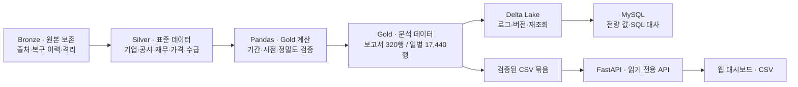

# ZERO ↗ · 기업의 흐름을 읽다

**실적은 좋아졌는데 주가는 왜 다르게 움직일까요?**
TEAM ZERO는 기업 실적·현금흐름·투자자 수급·주가를 연결해, 함께 개선되는 구간과 서로 어긋나는 구간을 탐색하는 데이터 분석 대시보드입니다.

[화면 둘러보기](docs/dashboard-gallery.md) · [로컬 실행](#로컬-실행) · [데이터와-레이어](#bronze--silver--gold) · [검증 결과](#검증-결과) · [팀 개발 안내](START_HERE.md)


> **분석 범위:** 20종목 · 가격 872거래일 · 재무 보고서 320건 · 데이터 최종일 2026-06-30
> 고정 데이터 기반의 분석 서비스입니다. 동행·괴리는 관측 결과이며 인과관계나 매매 추천을 뜻하지 않습니다.

## 무엇을 볼 수 있나요?

| 화면 | 확인할 수 있는 내용 |
|---|---|
| 기업 개요 | 기준일 종가, 매출 성장률, 시장 대비 성과, 복합 동반 개선 여부 |
| 주가와 시장 | 조회 구간 첫 관측일을 100으로 맞춘 종목·시장 추이 |
| 실적과 현금흐름 | 같은 보고서 유형의 매출·영업이익·순이익·영업현금흐름 비교 |
| 투자자 수급 | 외국인·기관 순매수, 관측 구간별 수급과 가격의 흐름 |
| 종목 비교 | 매출 성장과 공시 후 시장 대비 성과의 동행·괴리 비교 |
| 판단 근거 | 계산식·기간·보고서·연결/별도·출처·품질 상태와 정확한 원값 |
| CSV 다운로드 | 현재 조회 조건의 데이터와 분석 결과 반출 |

차트의 관측점 탐색·범례 선택·기간 필터를 지원합니다. 큰 금액은 조·억 단위로 읽고, 원값 보기와 CSV에서 정확한 값을 확인할 수 있습니다.

<details>
<summary><strong>화면 투어 보기</strong></summary>


실제 API 연결 화면 7장을 순환하는 GIF입니다. [원본 화면과 설명](docs/dashboard-gallery.md)에서 확대해 볼 수 있습니다.

</details>

## Bronze → Silver → Gold

이번 프로젝트는 **완료된 Silver 인계본을 활용해 분석 목적의 Gold와 웹 서비스를 만드는 프로젝트**입니다. 기존 표준 사전과 변환 결과를 재사용하며, 추가 확보한 원본의 저장·검증은 별도 파이프라인에서 수행합니다.



그림의 웹 수용 검증 경로는 **CSV 묶음 → API → 화면**입니다. 신규 Gold의 Delta·MySQL 저장은 실제 검증했으며, 신규 MySQL 테이블에서 API까지 직접 조회하는 경로와 구분합니다.

| 레이어 | 담는 내용 | 보존·활용 방식 |
|---|---|---|
| **Bronze** | OpenDART·증권 데이터 입력, 원본 메타, 정화·복구·격리 이력 | 입력 출처와 변경 근거를 추적합니다. 원본 보유 여부와 최초 오염 원본 재현 여부를 구분합니다. |
| **Silver** | 기업·종목·매핑, 공시·원문 메타, 재무 보고서·지표·계정, 가격·지수·투자자 수급·보유·CFD·품질 이슈 | 제공된 **17테이블·371,437행**을 읽기 전용으로 재사용합니다. 키·단위·기간·상태를 유지합니다. |
| **Gold** | 보고서별 실적·현금흐름 지표, 일별 가격·시장 성과·수급 윈도·시점 재무·동행 분류 | 기존 Gold 2개를 보존하고, 목적별 분석 Gold 2개를 추가합니다. |

### 분석용 Gold 테이블

| 테이블 | 행 단위·건수 | 주요 결과 |
|---|---|---|
| `g_fin_rpt_analysis` | 재무 보고서 · **320행** | 전년동기 매출 성장, 영업이익률, 현금흐름 변화·매출 대비 현금흐름, 재무 상태·검증 플래그 |
| `g_stock_daily_analysis` | 종목 × 거래일 · **17,440행** | 수익률·시장 대비 성과, 5/20관측 수급, 시점 적격 재무, 동행·괴리 및 복합 동반 개선 |

기업 20종목은 KOSPI 14개·KOSDAQ 6개입니다. 가격은 2022-12-01~2026-06-30, 재무는 2022~2025년 보고서입니다. 기존 `g_ai_stock_daily`·`g_fin_rpt_mkt_smry`와 신규 분석 테이블은 서로 다른 산출물입니다.

[전체 테이블·컬럼·관계](docs/data-catalog.md) · [데이터 안내](docs/data-guide.md) · [Gold 스키마](analysis/evidence/schema.json) · [분석 계약](contracts/analysis.md)

### 숫자를 해석하는 기준

- **공시일 < 거래일:** 공시 시각이 없는 데이터에서 공시 당일 재무를 사용하지 않습니다.
- **기간 구분:** YTD·Q3M·ASOF, 연결·별도, 검증 기간·가정 기간을 구분합니다.
- **중복 합산 방지:** 일별로 연결된 재무를 반복 합산하거나 기관 합계와 기관 세부를 이중 합산하지 않습니다.
- **정밀도 보존:** 금액은 원, 수급은 주, 비율은 소수 비율입니다. Decimal 기반 계산 결과를 API에서 문자열로 전달합니다.
- **상태 보존:** NULL·0·미연결·격리·REVIEW를 구분합니다. 분모 0·음수 기준·관측 부족·기간 미검증은 계산 불가 사유로 표시합니다.

## 로컬 실행

### 1. 환경 준비

macOS/Linux 기준입니다. **Python 3.12(B), Python 3.13(C), Node 22.12 이상**을 사용합니다. Windows 설정은 [B 서비스 안내](backend/service/README.md)를 참고하세요.

```bash
git clone https://github.com/2nd-MLOps-engineer-2/Team-Zero.git
cd Team-Zero
```

현재 서비스 통합 기준은 `integration`입니다. main 승격 전에는 해당 브랜치 또는 이 README가 포함된 작업 브랜치를 사용합니다. 이미 작업 중이라면 변경을 보존한 후 통합합니다.

```bash
# 새 clone에서 서비스 통합본 사용
git switch integration

python3.12 -m venv build/b-venv
build/b-venv/bin/python -m pip install -r backend/service/requirements.lock.txt
python3.13 -m venv build/c-venv
build/c-venv/bin/python -m pip install -r analysis/requirements.txt
npm --prefix apps/web ci
```

### 2. Gold 생성·API 입력 준비

```bash
python3 scripts/check_handoff.py
build/c-venv/bin/python -m analysis.run --output build/analysis
build/b-venv/bin/python backend/service/pack_c_analysis.py \
  --source build/analysis --output build/c-artifact --project-root .
```

Silver는 저장소에 포함되어 있어 다시 업로드할 필요가 없습니다. API 묶음의 출력 경로가 이미 있으면 패키징 도구가 거부하므로 재실행할 때 새 출력 이름을 사용하세요.

### 3. API 실행

```bash
build/b-venv/bin/python backend/service/run.py \
  --backend csv --project-root . --analysis-dir build/c-artifact --port 8000
```

### 4. 별도 터미널에서 화면 실행

```bash
VITE_DATA_MODE=api VITE_API_BASE_URL=http://127.0.0.1:8000 \
  npm --prefix apps/web run dev -- --port 5173 --strictPort
```

- 대시보드: <http://127.0.0.1:5173>
- OpenAPI: <http://127.0.0.1:8000/docs>
- 종료: 각 터미널에서 `Ctrl+C`

화면 기본 모드는 fixture입니다. 위 API 설정을 사용해야 실제 제공 데이터와 연결됩니다. `--analysis-dir`를 생략하면 신규 C 분석은 미연결 상태로 표시됩니다.

## 검증 결과

**2026-10-15 기준**, 실제 제공 데이터와 격리된 로컬 DB 및 GitHub CI로 확인한 결과입니다. 완료된 기능 통합과 최종 main 승격은 구분합니다.

| 검증 | 결과 |
|---|---|
| 인계본 무결성 | 75파일 해시·크기, 33 CSV 헤더·건수 PASS |
| Gold 재생성 | 320 + 17,440행, 기존 제출 결과 해시 일치 |
| Delta → MySQL | 두 Gold 전체 행·컬럼 값 일치 |
| 독립 SQL | **222개 PASS** — NULL·합계·공시일·성장률 대사 |
| C / B API | **49 PASS / 49 PASS·2 SKIP** |
| B 저장 안전성 | 모의 환경 **6 PASS** |
| A 단위 / 빌드 / 브라우저 | **17 PASS / PASS / 18 PASS** |
| 실제 CSV API·다운로드 | 일별·재무·20종목 비교, 값 차이 **0** |
| GitHub 통합 CI | **PASS** — MySQL 8.4·실제 API·브라우저 포함 |

[GitHub 통합 실행 결과](https://github.com/2nd-MLOps-engineer-2/Team-Zero/actions/runs/38698470092) · [Gold 수용 기록](docs/handoffs/Gold-final-acceptance.md) · [SQL 증빙 JSON](analysis/evidence/gold-storage-validation.json) · [S5 기록](docs/handoffs/S5-integration.md)

B 검사 2개는 기존 외부 실행 카탈로그가 필요한 항목으로, 이번 실행에서는 제외됐습니다. CSV의 숫자 표기 차이는 허용하되 키·행·컬럼·값을 대조합니다. 바이트 동일과 값 동일은 구분합니다. 과거 인계본의 203 PASS를 신규 서비스 검증 수치에 합산하지 않습니다.

<details>
<summary><strong>직접 검사하기</strong></summary>

```bash
build/c-venv/bin/python -m unittest discover -s analysis/tests -q
build/b-venv/bin/python -m pytest backend/service/tests -q
npm --prefix apps/web test
npm --prefix apps/web run build
```

Delta/MySQL 신규 DB 대사는 [Gold 수용 기록](docs/handoffs/Gold-final-acceptance.md)을 따릅니다. 실제 API·브라우저까지 포함하는 재현 절차는 [통합 CI](.github/workflows/integration.yml)에 있습니다.

</details>

### 데이터 제약과 남은 범위

기간 미검증 **61보고서**, 시점 재무 미연결 **1,607행**, 수급 격리 **1키**, 기간 연속성 REVIEW를 상태값으로 보존합니다. 이를 임의 값이나 0으로 채우지 않습니다.

신규 Gold 저장·CSV API·화면 수용 검증은 완료했습니다. **전체 Bronze 재현·기존 58테이블 복원 증빙의 최종 검토, 신규 MySQL → API 직접 조회 검증, main 승격·운영 배포**는 별도 범위입니다. 고정 인계본에는 별도 Bronze 입력·공시 원문 ZIP·덤프·Delta 실파일이 모두 포함되는 것은 아닙니다.

## 기술 구성과 팀

| 영역 | 기술·담당 | 구현 경로 |
|---|---|---|
| 화면 | Vite · JavaScript · Playwright / **A 이어진** | `apps/web/` |
| 저장·API | FastAPI · Delta Lake · MySQL / **B 설호현** | `backend/service/`, `backend/medallion_pipeline/` |
| 분석·검증 | Pandas · NumPy · Decimal · Matplotlib / **C 김형준** | `analysis/` |
| 공통 | 계약·샘플·인수인계·GitHub Actions | `contracts/`, `fixtures/`, `docs/handoffs/`, `.github/workflows/` |

고정 인계본은 `data/03_C_integration_20261014/`에 보존합니다. 생성물·DB·Delta·실행 로그는 `build/` 등 별도 위치에 두며 비밀번호와 DB 덤프를 커밋하지 않습니다.

팀원은 [AGENTS.md](AGENTS.md) → [START_HERE.md](START_HERE.md) → [본인 역할 프롬프트](prompts/) 순서로 시작합니다. 작업 브랜치에서 개발하고 단계별 검증·수신 확인 후 integration에 통합합니다.

[프로젝트 설계](docs/project-plan.md) · [업무 체크북](docs/workbook.md) · [계약 모음](contracts/README.md) · [통합 진행표](docs/integration-status.md) · [브랜치·인수인계 절차](docs/integration-workflow.md)
