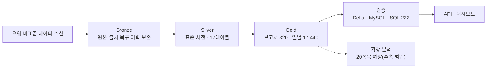
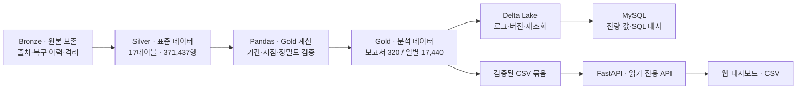
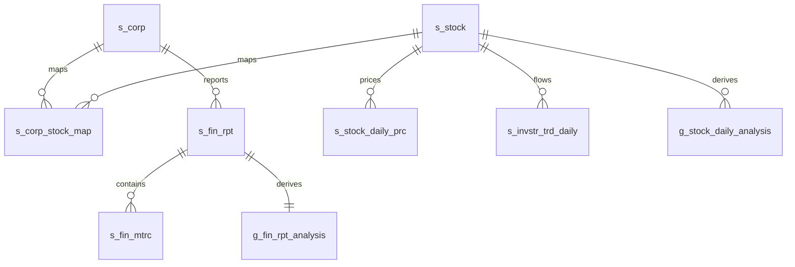
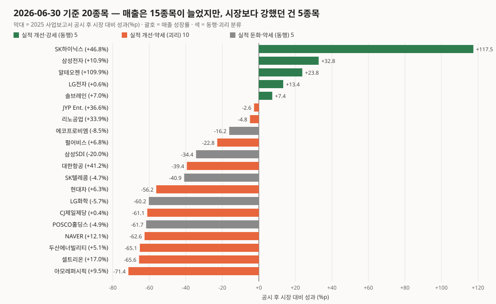
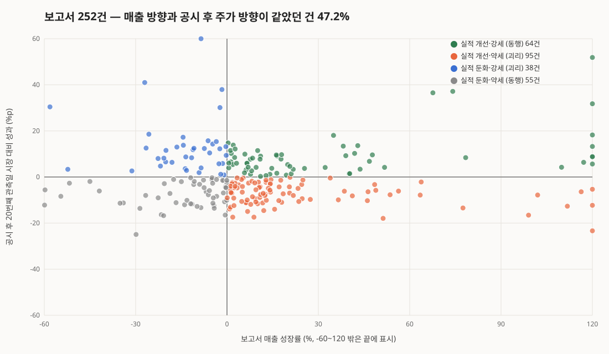
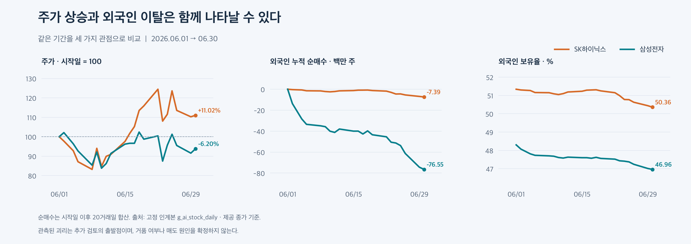
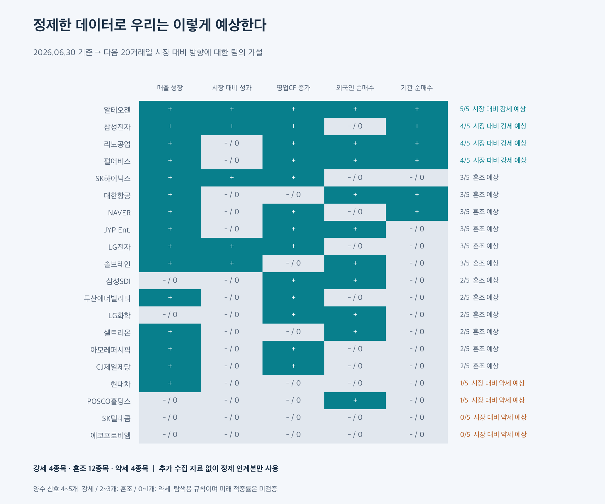
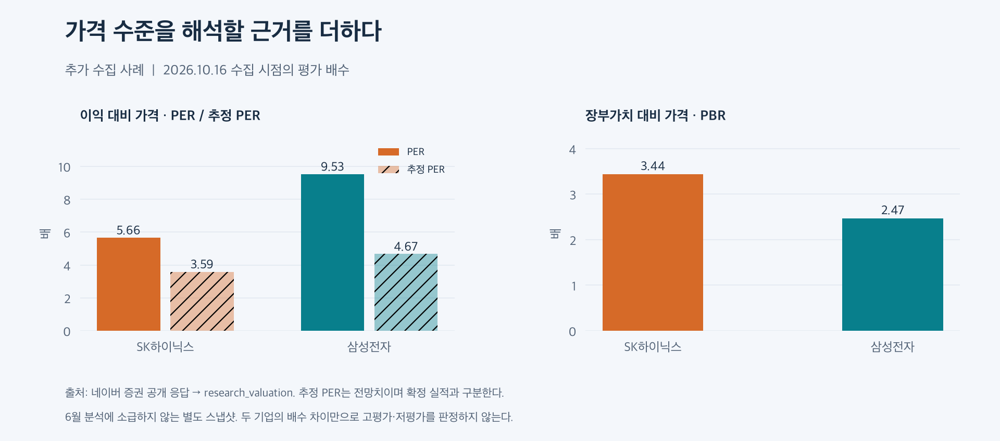

# TEAM ZERO · 레거시 데이터의 AI Ready Data 변환 및 표준 사전 구축

**오염된 레거시 금융 데이터를 Bronze에 보존하고, Silver에서 표준화·연결하고, Gold에서 공시 시점을 지킨 분석 데이터로 만들어 검증했습니다.**

TEAM ZERO는 형식·명명·코드·기간 기준이 섞인 금융 레거시 데이터를 받아, 기업과 종목을 연결하고 재무·주가·수급을 같은 기준으로 비교할 수 있게 정제했습니다.

**우리의 주 결과**

- **Bronze — 보존:** 오염 원본과 출처·정화·복구·격리 이력을 남겼습니다. OpenDART 107,846셀을 변경 이력으로 복원하고, 원값을 확정할 수 없는 토스증권 741행은 격리해 추적합니다.
- **Silver — 표준화:** 표준 사전(단어 168·용어 345·도메인 26·공통코드 133)을 적용한 17테이블·371,437행입니다. 표준 준수율은 2.92%에서 100%가 됐습니다.
- **Gold — 분석:** 보고서 320행과 일별 17,440행입니다. 공시일보다 뒤인 거래일에만 재무를 연결하고, 기관 이중 합산과 재무 반복 합산을 막았습니다. Delta → MySQL 전량 대사와 독립 SQL 222개가 PASS입니다.
- **활용:** 읽기 전용 API와 대시보드에서 실적·현금흐름·외국인·기관 수급·시장 대비 성과와 계산 근거를 함께 보여줍니다.



**확장 분석(후속 범위):** 정제한 Gold로 20종목의 이후 20거래일 시장 대비 방향을 탐색 규칙으로 예상했습니다(강세 4·혼조 12·약세 4). 적중률을 검증하지 않은 가설이며 매매 추천이 아닙니다. [6장 확장 분석](#확장-분석--정제-데이터로-계산한-20종목-예상-후속-범위) · [20종목 전체 결과](docs/research/cleaned-data-forecast.md)

ZERO 대시보드는 이 분석의 실적·현금·시장 흐름과 계산 근거를 보여줍니다. 이번에 공개한 20종목 예상은 저장소의 계산 코드·결과로 제공하며 웹 화면에 별도 예상 카드가 연결된 상태는 아닙니다.


| 20종목 | 872거래일 | 320 보고서 | Silver 17테이블 · 371,437행 | 신규 Gold 17,760행 | 독립 SQL 222 PASS |
|:-:|:-:|:-:|:-:|:-:|:-:|
| KOSPI 14 · KOSDAQ 6 | 2022-12-01 ~ 2026-06-30 | 2022~2025 사업연도 | 제공 인계본 재사용 | 보고서 320 + 일별 17,440 | Delta → MySQL 전량 일치 |

> 동행·괴리 분류와 예상은 관측 패턴과 팀의 탐색 규칙이며 인과관계나 매매 신호가 아닙니다. 10월 추가 수집 자료를 쓴 과열 예상은 별도 시점의 확장 분석입니다.

[화면 둘러보기](docs/live-screen-review.md) · [인사이트](#6-인사이트--이-데이터로-무엇을-알게-됐나) · [활용 제안](#7-활용--이-데이터로-무엇을-할-수-있나) · [검증 결과](#8-검증--검사마다-확인한-범위가-다릅니다) · [로컬 실행](#11-로컬-실행) · [상세 문서(전체판)](docs/project-details.md) · [팀 개발 안내](START_HERE.md)

**DB 내려받기:** [60테이블 복원 검증 스냅샷](https://github.com/2nd-MLOps-engineer-2/Team-Zero/releases/tag/db-snapshot-20261016) · [첨부 DB와 추가 수집 자료의 차이](#db-스냅샷-다운로드와-추가-자료)

## 프로젝트 개요

**주제: 레거시 데이터의 AI Ready Data 변환 및 표준 사전 구축**

- 1팀↔2팀, 3팀↔4팀이 현업 레거시 환경을 재현하도록 품질 결함(결측·중복·형식 불일치·코드값 혼용·명명 규칙 불일치)을 반영한 레거시 데이터셋과 데이터 명세서를 상호 교환하고, 제공받은 데이터를 대상으로 Pandas 기반 프로파일링을 수행하여 현행(AS-IS) 품질 문제를 수치로 진단
- 진단 결과를 바탕으로 표준 단어·용어·도메인·코드를 정의하고, 표준 단어 조합 규칙과 데이터 타입·길이·허용값을 포함한 AI 데이터 표준 사전 구축
- 표준 사전을 적용하여 Delta Lake Medallion(Bronze→Silver→Gold) 레이어 구조 기반의 TO-BE 모델(개념·논리·물리 ERD, 정규화, 식별키·관계)을 설계하고 MySQL에 레이어별 테이블로 구현
- 레거시 데이터를 표준 모델로 변환·적재한 뒤 레이어 간 건수 대사, 키 무결성, 표준 준수율, 도메인·코드 규칙 위반 건수를 SQL·Pandas로 검증하여 AI 학습에 바로 사용할 수 있는 데이터셋 확정

| 수행 단계 | 내용 |
|---|---|
| 1 | 데이터 프로파일링 및 현행(AS-IS) 분석 |
| 2 | 데이터 표준화 전략 수립(표준 사전 구축) |
| 3 | AI Ready Data 모델링(TO-BE 설계) — Delta Lake Medallion(Bronze→Silver→Gold) 레이어 구조 기반 설계 |
| 4 | 데이터 변환 및 정합성 검증 |
| 5 | 결과물 패키징 및 회고 |

**주요 산출물**
- AS-IS 데이터 프로파일링 리포트 및 AI 데이터 표준 사전
- AI Ready Data 모델링(TO-BE) 명세서 및 정합성 검증 데이터셋

**최종 제시물:** 정제 전후 검증 증빙 → 정제 데이터로 계산한 20종목 예상 → 종목별 근거와 재현 코드. 단계별로 실제 수행한 내용과 산출물 위치는 [2장](#2-과제와-우리의-답--5단계-산출물)에 정리했습니다.

## 목차

1. [문제 — 실적과 주가는 왜 따로 보면 안 되나](#1-문제--실적과-주가는-왜-따로-보면-안-되나)
2. [과제와 우리의 답 — 5단계 산출물](#2-과제와-우리의-답--5단계-산출물)
3. [데이터와 구조 — Bronze → Silver → Gold](#3-데이터와-구조--bronze--silver--gold)
4. [분석 규칙 — 공개된 이후의 정보만 연결](#4-분석-규칙--공개된-이후의-정보만-연결)
5. [화면 — 기업 개요에서 판단 근거까지](#5-화면--기업-개요에서-판단-근거까지)
6. [인사이트 — 이 데이터로 무엇을 알게 됐나](#6-인사이트--이-데이터로-무엇을-알게-됐나)
7. [활용 — 이 데이터로 무엇을 할 수 있나](#7-활용--이-데이터로-무엇을-할-수-있나)
8. [검증 — 검사마다 확인한 범위가 다릅니다](#8-검증--검사마다-확인한-범위가-다릅니다)
9. [트러블슈팅 — 실제로 부딪힌 문제](#9-트러블슈팅--실제로-부딪힌-문제)
10. [한계와 다음 단계](#10-한계와-다음-단계)
11. [로컬 실행](#11-로컬-실행)
12. [팀과 기술 구성](#12-팀과-기술-구성)

---

## 1. 문제 — 실적과 주가는 왜 따로 보면 안 되나

재무는 **보고서 단위**, 가격·수급은 **거래일 단위**입니다. 식별자도 기업 코드와 종목 코드로 다릅니다. 코드만 맞춰 합치면 두 가지 문제가 생깁니다.

- 공시 전에는 알 수 없었던 정보를 과거 주가에 붙이게 됩니다.
- 같은 누적 실적을 매일 다시 더하게 됩니다.

| 기존 분석에서 생기는 문제 | ZERO의 처리 | 사용자가 얻는 것 |
|---|---|---|
| 실적과 주가를 각각 확인 | 보고서·일별 Gold를 기업·종목 관계로 연결 | 실적·현금·시장 흐름을 한 화면에서 |
| 결산일 기준으로 과거 주가에 재무를 붙임 | **실제 공시일보다 뒤인 거래일에만** 연결 | 미래 정보 참조를 막은 비교 |
| 누적·분기·기말 값을 섞어 비교 | YTD·Q3M·ASOF, 연결·별도 구분 | 같은 의미끼리의 비교 |
| 매출은 늘었지만 현금·수급은 약할 수 있음 | 현금흐름·수급을 보조 근거로 함께 제공 | 숫자 하나로 결론 내리지 않음 |
| 결측을 0으로 바꾸면 해석이 틀어짐 | NULL·0·미연결·격리·검토 상태 분리 | 분석할 수 없는 이유까지 확인 |
| 분석 파일과 웹 숫자가 다를 수 있음 | Pandas·Delta·MySQL·API·CSV 단계별 대사 | 표시값의 출처와 검증 경로 |

> **공동 목표:** 기업 실적·현금흐름·투자자 수급·주가의 동반 개선과 괴리를 탐색하고, 판단 근거와 데이터 품질 상태를 함께 제공한다.

**사용 흐름:** 시장·기준일 선택 → 20종목 비교에서 기업 선택 → 매출 성장과 시장 대비 성과 확인 → 실적·현금흐름·외국인·기관 수급 비교 → 보고서·공시일·기간·품질 상태 확인 → 같은 조건의 원값·CSV 확인

## 2. 과제와 우리의 답 — 5단계 산출물

과제의 5단계를 실제로 어떻게 수행했고 결과물이 어디 있는지 정리했습니다.

| 단계 | 한 일 | 결과물 |
|---|---|---|
| **1. AS-IS 프로파일링** | 결측·중복·형식·코드·명명·값/기간 문제를 Pandas로 수치화. 허용 결측과 실제 결함 구분 | [AS-IS 프로파일링 리포트](data/03_C_integration_20261014/01_profiling/) |
| **2. 표준화 전략** | 단어 168 · 용어 345 · 도메인 26 · 공통코드 133 · 명명규칙 12 · 표준 테이블 23 · 컬럼 매핑 260 | [AI 데이터 표준 사전](data/03_C_integration_20261014/02_standard_dictionary/) |
| **3. TO-BE 모델링** | 개념·논리·물리 ERD, 정규화·식별키·관계, Delta Lake Bronze→Silver→Gold 설계와 MySQL 레이어별 테이블 구현 | [TO-BE 명세·ERD·DDL](data/03_C_integration_20261014/03_model/) |
| **4. 변환·정합성 검증** | 레이어 간 건수 대사, 키 무결성, 표준 준수율, 도메인·코드 규칙 위반 건수를 SQL·Pandas로 검증 | [정합성 검증 결과](data/03_C_integration_20261014/05_validation/), 분석용 Gold 데이터셋 |
| **5. 패키징·회고** | 실행법·버전·해시·잔여 이슈·인수인계 | [최종 보고](data/03_C_integration_20261014/06_report/)·재현 가능한 제출 패키지 |

- 표준 준수율은 **AS-IS 2.92% → TO-BE 100%** 이고, TO-BE 도메인·코드 위반은 0건입니다. 보존된 과거 인계본 검증 203/203 PASS 기준입니다.
- 코드는 선행 0을 보존합니다. 예를 들어 기업 코드는 CHAR(8)입니다. 식별자를 금액처럼 숫자로 바꾸지 않습니다.
- 대시보드는 이 과정의 **Gold 활용 시연**입니다. 진단·표준 사전·모델링·검증 산출물을 대신하지 않습니다.

## 3. 데이터와 구조 — Bronze → Silver → Gold



| 레이어 | 담는 내용 | 이번 프로젝트에서 |
|---|---|---|
| **Bronze** | OpenDART·증권 데이터 입력, 원본 메타, 정화·복구·격리 이력 | 출처와 변경 근거 추적 |
| **Silver** | 기업·종목·공시·재무·가격·지수·수급·보유·품질 이슈 | 제공된 **17테이블·371,437행**을 읽기 전용으로 재사용 |
| **Gold** | 보고서별 실적·현금흐름, 일별 시장 성과·수급·시점 재무·동행 분류 | 기존 Gold 2개 보존 + **목적별 분석 Gold 2개 추가** |

| 신규 Gold | 행 단위 · 건수 | 주요 결과 |
|---|---|---|
| `g_fin_rpt_analysis` | 재무 보고서 · **320행** | 전년동기 매출 성장, 영업이익률, 현금흐름 변화, 재무 상태·검증 플래그 |
| `g_stock_daily_analysis` | 종목 × 거래일 · **17,440행** | 수익률·시장 대비 성과, 5/20관측 수급, 시점 적격 재무, 동행·괴리·복합 동반 개선 |

- 데이터 출처는 두 계열의 인계 데이터입니다.
  - OpenDART 계열: 기업·공시·재무
  - 토스증권 계열: 종목·OHLCV·지수·투자자 매매·외국인 보유·CFD
- 조회 서버는 이 스냅샷만 읽습니다. 화면을 열 때마다 외부에서 새로 수집하지 않습니다.
- 계산 버전은 `c-gold-0.1.0`입니다.
- 기업과 종목은 `s_corp_stock_map`으로 연결하고, 각 행은 `corp_cd`·`stock_cd`·`rcept_no`·`fin_rpt_id`로 추적합니다.

<details>
<summary><strong>Silver 17테이블 행 수와 주요 관계 보기</strong></summary>

| 테이블 | 행 수 | 행 단위 |
|---|---:|---|
| `s_corp` / `s_stock` / `s_corp_stock_map` | 20 / 20 / 20 | 기업 / 종목 / 기업·종목 대응 |
| `s_dscl` / `s_dscl_doc` | 11,748 / 753 | 공시 접수번호 / 원문 대상 메타 |
| `s_fin_rpt` / `s_fin_mtrc_def` / `s_fin_mtrc` / `s_fin_item` | 320 / 36 / 30,080 / 66,729 | 보고서 / 지표 정의 / 보고서·지표·기간 / 상세 항목 |
| `s_stock_daily_prc` / `s_idx_daily_prc` | 17,440 / 1,744 | 종목·거래일 / 지수·거래일 |
| `s_invstr_trd_daily` / `s_frgn_hold_daily` / `s_cfd_bal_daily` | 191,829 / 17,439 / 13,719 | 투자자 유형별 매매 / 외국인 보유 / CFD 잔고 |
| `s_conn_stts` / `s_dq_issue` / `s_cmn_cd` | 17,440 / 1,967 / 133 | 연결 상태 / 품질 이슈 / 공통 코드 |

합계 371,437행은 서로 다른 행 단위를 더한 물리 행 수입니다. 고유 표본 수가 아닙니다.



Gold로 이어지는 선은 분석 계보를 나타냅니다. 모든 선이 물리 FK라는 뜻은 아닙니다. 인계본 물리 ERD: [03_physical_erd.png](data/03_C_integration_20261014/06_report/img/03_physical_erd.png) · 전체 테이블·컬럼: [데이터 카탈로그](docs/data-catalog.md)

</details>

## 4. 분석 규칙 — 공개된 이후의 정보만 연결

핵심은 **미래 정보를 과거 날짜에 붙이지 않는 것**입니다.

- **공시일 < 거래일:** 공시 시각이 없으므로 공시 당일 재무는 사용하지 않습니다. 6월 15일에 공시된 보고서는 그 다음 거래일부터 연결합니다.
- **기간 구분:** YTD(누적)·Q3M(3개월)·ASOF(기말)와 연결(CFS)·별도(OFS)를 섞지 않습니다.
- **중복 합산 방지:** 일별로 반복된 재무를 다시 합하지 않습니다. 기관 합계와 기관 세부도 함께 더하지 않습니다.
- **정밀도:** 금액은 원, 수급은 주, 비율은 소수로 다룹니다. Decimal과 HALF_UP 소수 8자리로 계산하고, API는 숫자를 문자열로 전달합니다.
- **상태 보존:** NULL·0·미연결·격리·REVIEW를 구분합니다. 분모가 0이거나 기간이 검증되지 않았으면 "계산 불가"와 그 사유를 남깁니다.

### 핵심 지표

| 지표 | 계산 |
|---|---|
| 매출 성장률 | 당기 YTD 매출 / 전년동기 YTD 매출 − 1 |
| 영업이익률 · 영업CF/매출 | YTD 영업이익 / YTD 매출 · YTD 영업CF / YTD 매출 |
| 부채비율 | 기말 부채 / 기말 자본 (ASOF끼리) |
| 시장 대비 성과 | 종목 성과 − 같은 구간 지수 성과 (%p) |
| 5·20관측 순매수 · 순매수 비율 | 최근 n개 관측의 순매수 합 · 순매수 합 / 거래량 합 |
| 공시 후 시장 대비 성과 | 공시 직전 거래일 → 조회일의 종목 성과 − 지수 성과 |

### 동행·괴리 분류

| 매출 성장률 | 공시 후 시장 대비 성과 | 분류 |
|:-:|:-:|---|
| + | + | `IMPROVE_STRONG` 실적 개선·강세 **동행** |
| + | − | `IMPROVE_WEAK` 실적 개선·약세 **괴리** |
| − | + | `SLOW_STRONG` 실적 둔화·강세 **괴리** |
| − | − | `SLOW_WEAK` 실적 둔화·약세 **동행** |

- 하나라도 0이면 `NEUTRAL`, 필수 값이 없으면 `UNAVAILABLE`입니다.
- **복합 동반 개선**은 다섯 값이 모두 양수일 때 Y입니다: 매출 성장, 공시 후 초과성과, 영업CF 증감, 외국인 20관측 순매수, 기관 20관측 순매수.
- 이 분류는 매수 신호가 아닙니다.

## 5. 화면 — 기업 개요에서 판단 근거까지

2026-10-15에 실제 CSV API와 C Gold를 연결해 Chromium에서 직접 캡처했습니다. 조건은 삼성전자(005930), 주가 2026-06-01~06-30, 사업보고서·연결입니다. 숫자를 합성하거나 차트를 다시 그리지 않았습니다.

| 주가와 시장 | 실적과 현금흐름 |
|:-:|:-:|
|  |  |
| 출발점을 100으로 맞춰 종목과 시장의 상대 흐름을 봅니다 | 같은 보고서 유형·연결구분끼리 비교합니다. NULL 구간은 이어 그리지 않습니다 |
| **투자자 수급** | **종목 비교** |
|  |  |
| 외국인·기관 순매수의 양수·음수를 비교합니다 | 매출 성장과 시장 대비 성과의 동행·괴리를 봅니다 |


**판단 근거** 영역에서는 계산식·기간·보고서·공시일·출처·품질 상태와 정확한 원값을 확인하고, 같은 조건의 데이터를 CSV로 내려받을 수 있습니다.

캡처 시점 삼성전자 수치는 다음과 같습니다(2026-06-30 스냅샷 기준).
- 종가 333,000원
- 매출 성장률 10.88%
- 공시 후 시장 대비 성과 32.77%p
- 복합 동반 개선: 조건 미충족

[전체 캡처·재검토 기록](docs/live-screen-review.md) · [이미지 해시·검증 메타](docs/media/live-review-20261015/capture-manifest.json)

## 6. 인사이트 — 이 데이터로 무엇을 알게 됐나

데이터를 만들고 끝내지 않았습니다. 완성한 Gold(보고서 320행·일별 17,440행)로 처음 질문에 답해 봤습니다.

> **"주가가 오른 만큼 기업의 실적과 현금 창출도 좋아졌을까? 외국인은 파는데 주가가 오른다면, 그 상승을 무엇이 뒷받침할까?"**

이것이 프로젝트의 출발점입니다. 기존 실적·주가 분석에 **외국인 보유 변화·가치평가·사업 전망**을 더해, 상승의 근거와 과열을 의심할 만한 괴리를 함께 살핍니다. 기업의 내재가치나 거품 여부를 확정했다는 뜻은 아닙니다.

아래 ①~⑥은 기존 데이터 기준 분석입니다. ⑦~⑧의 추가 수집 자료와 팀 예상은 수집 시점을 따로 표시합니다.
- 기준일: 2026-06-30
- 계산 버전: `c-gold-0.1.0`
- 공시일 다음 거래일부터 연결(PIT)
- 기간 미검증 61보고서는 계산에서 제외(상태로 보존)

### 한 장 요약

| 15 / 20종목 | 5종목 | 47.2% | 38.4% | 5.7% |
|:-:|:-:|:-:|:-:|:-:|
| 2025년 매출이 늘어난 종목 | 그중 공시 후 시장보다 강했던 종목 | 매출 방향과 공시 후 주가 방향이 같았던 보고서 비율 | 매출이 늘었는데 영업현금은 줄어든 보고서 비율 | 다섯 조건이 모두 좋은 '복합 동반 개선' 일수 비율 |

### ① 실적이 좋아도 주가는 절반만 따라왔다



기준일 기준으로 2025 사업보고서 매출이 늘어난 종목은 **15개**입니다. 그런데 공시 후 시장보다 강했던 종목은 **5개**(SK하이닉스·삼성전자·알테오젠·LG전자·솔브레인)뿐입니다.

- **실적 개선인데 시장 대비 약세(괴리):** 10종목. NAVER(매출 +12.1%), 셀트리온(+17.0%), 대한항공(+41.2%) 등입니다.
- **실적 둔화·약세(동행):** 5종목
- **실적 둔화인데 강세:** 0종목

### ② 매출 하나로는 주가 방향을 설명할 수 없었다



시점을 기준일 하루가 아니라 **보고서 252건 전체**로 넓혔습니다. 각 보고서가 공시된 뒤 20번째 거래일의 시장 대비 성과를 비교했습니다.

- 매출 방향과 주가 방향이 같았던 경우는 **47.2%** 입니다. 동전 던지기와 비슷합니다.
- 순위 상관(Spearman)은 **0.007** 로 사실상 0입니다.
- 일별 15,833행 전체로 봐도 동행 48.5%, 괴리 51.5%입니다.

→ **실적 숫자 하나만 보고 주가를 판단하면 안 된다**는 것이 데이터로 확인됐습니다. ZERO가 현금흐름·수급·공시 시점을 함께 보여 주는 이유입니다.

### ③ 매출이 늘어도 현금은 줄어든 보고서가 많다

매출이 늘어난 보고서 164건 중 **63건(38.4%)** 은 영업현금흐름이 전년동기보다 줄었습니다. 기준일에 이 조건에 해당하는 종목은 **대한항공·현대차·셀트리온·솔브레인** 4개입니다.

같은 기간 영업이익이 **흑자→적자로 바뀐 보고서는 14건**, **적자→흑자는 10건**이었습니다.

### ④ 다섯 조건이 모두 좋은 순간은 드물다

복합 동반 개선은 다섯 조건이 모두 양수인 날입니다: 매출 성장, 공시 후 초과성과, 영업현금 증가, 외국인 순매수, 기관 순매수.

- 판단 가능한 15,813일 중 **908일(5.7%)** 뿐입니다.
- 기준일에 이 조건을 충족한 종목은 **알테오젠 1개**입니다.
- 일수로는 두산에너빌리티(166일)·알테오젠(141일)·NAVER(125일) 순으로 많았습니다.

### ⑤ 괴리 종목에도 외국인·기관 수급이 들어온 경우가 있다

기준일에 외국인과 기관이 최근 20거래일 동안 **함께 순매수**한 종목은 4개입니다.

- **알테오젠:** 동행
- **대한항공·리노공업·펄어비스:** 실적 개선·약세(괴리)

실적과 수급은 좋은데 시장 대비 주가는 약한, 해석이 엇갈리는 종목입니다.

### ⑥ 주가는 오르는데 외국인은 팔고 있다면?

같은 2026-06-01~06-30 구간을 직접 대조했습니다. 주가는 양 끝 종가 수익률, 순매수는 시작일 이후 20거래일 합, 보유율은 양 끝 차이입니다.



| 종목 | 주가 수익률 | 외국인 순매수 | 외국인 보유율 변화 |
|---|---:|---:|---:|
| SK하이닉스 | +11.02% | -7,392,456주 | -0.98%p |
| 삼성전자 | -6.20% | -76,545,220주 | -1.34%p |

SK하이닉스에서는 **주가 상승과 외국인 이탈이 동시에 관측**됐습니다. 삼성전자는 같은 구간 주가도 하락했으므로 같은 상승 사례로 묶지 않았습니다. 외국인 매도만으로 거품을 단정할 수 없기에, 그 다음에는 실적·현금·가격 수준·사업 전망을 함께 확인해야 합니다.

### 확장 분석 — 정제 데이터로 계산한 20종목 예상 (후속 범위)

> 프로젝트 계획에서 예측은 기본 서비스 이후의 확장 범위입니다. 아래는 위 관측 결과를 바탕으로 팀이 정한 탐색 규칙의 결과이며, 적중률을 검증하지 않았고 매매 추천이 아닙니다.

**정제한 데이터를 이용해 우리는 이후 20거래일 동안 시장 대비 강세 4종목, 혼조 12종목, 약세 4종목을 예상합니다.** 기준일은 2026-06-30이며, 기준일 이후의 가격이나 10월 추가 수집 자료는 이 예상에 사용하지 않았습니다.

| 우리의 예상 | 종목 | 양수 신호 수 |
|---|---|---:|
| **시장 대비 강세 예상** | 삼성전자·리노공업·알테오젠·펄어비스 | 4~5 / 5 |
| **혼조 예상** | SK하이닉스·대한항공·삼성SDI·두산에너빌리티·NAVER·JYP Ent.·LG화학·LG전자·셀트리온·아모레퍼시픽·CJ제일제당·솔브레인 | 2~3 / 5 |
| **시장 대비 약세 예상** | 현대차·POSCO홀딩스·SK텔레콤·에코프로비엠 | 0~1 / 5 |



**예상 근거는 다섯 가지입니다:** 동일 보고서의 매출 전년동기 성장, 공시 이후 시장 대비 성과, 영업현금흐름 전년동기 증가, 최근 20관측 외국인 순매수, 기관 순매수. 각각 양수인지 계산해 4~5개면 강세, 2~3개면 혼조, 0~1개면 약세로 예상합니다. 동일 가중치·경계값은 팀이 정한 탐색용 규칙이며, 혼조는 신호가 엇갈리는 흐름을 예상한다는 뜻입니다.

| 대표 종목 | 정제 데이터에서 계산한 근거 | 그래서 우리는 |
|---|---|---|
| **삼성전자** | 매출 +10.88%, 영업CF 증가, 공시 후 시장 대비 강세, 기관 순매수. 외국인은 순매도 | 긍정 신호 4/5로 **시장 대비 강세를 예상** |
| **SK하이닉스** | 매출 +46.76%, 영업CF 증가, 공시 후 시장 대비 강세. 외국인·기관은 순매도 | 긍정 신호 3/5로 **실적과 수급이 엇갈리는 혼조를 예상** |
| **현대차** | 매출은 증가했지만 시장 성과·영업CF 증감·외국인·기관 수급은 양수 조건 미충족 | 긍정 신호 1/5로 **시장 대비 약세를 예상** |

#### 정제가 왜 이 예상의 전제인가

| 정제·검증한 것 | 그대로 분석하면 생기는 문제 | 예상에 실제 반영한 방식 |
|---|---|---|
| 기업·종목 코드와 관계 | 다른 기업의 재무·가격을 잘못 연결 | 같은 종목·보고서 ID의 실적과 시장 흐름 연결 |
| 연결/별도, 누적/분기, 당기/전년동기 | 비교 기간·범위가 다른 금액을 성장으로 오해 | 같은 보고서 YTD·PRIOR_YTD 매출·영업CF 비교 |
| 공시일과 거래일 | 미래에 공개될 실적을 미리 알았던 것처럼 계산 | 공시일 < 기준일인 적격 보고서만 사용 |
| 투자자 분류·수량 단위 | 기관 합계와 세부를 중복 합산 | 최상위 외국인·기관 수급만 각각 20관측 합산 |
| 결측·0·검토 상태 | 빠진 값을 0으로 바꿔 신호 왜곡 | 필수 입력·기간·현금흐름 검증 플래그 확인 후 계산 |

**정제·검증 PASS는 입력과 계산의 신뢰성에 대한 증거입니다.** 위 예상의 미래 적중률까지 증명한 것은 아닙니다. 20종목 모두 결과를 내되, 사용한 보고서·공시일·원값·규칙을 공개합니다.

[20종목 전체 수치·예상 규칙](docs/research/cleaned-data-forecast.md) · [입력 해시·보고서 ID·결과 JSON](docs/research/cleaned-data-forecast.json) · [정제 데이터만 사용하는 실행 코드](scripts/research/forecast_cleaned.py)

### 추가 수집 자료로 넓힌 확장 분석 (10월 스냅샷)

정제한 데이터로 위 예상을 만든 뒤, “주가가 기업가치보다 앞서간 것은 아닐까?”를 더 검토하기 위해 가치평가·최근 실적·사업 전망을 추가 수집했습니다. **10월 자료의 과열 예상은 별도 시점·별도 질문의 확장 결과**입니다. 삼성전자·SK하이닉스는 당시 PBR 부담과 실적 개선을 함께 고려해 과열 가능성이 일부 있다고 예상했습니다. 이 결과를 6월 예상과 합치거나 적중 검증으로 사용하지 않습니다.

[10월 과열 예상 20종목](docs/research/assessment.md) · [추가 수집 목적·출처](docs/research/additional-data.md)

### ⑦ 처음의 질문을 검토하기 위해 데이터를 추가로 수집했다

기존 과제는 **교환받은 레거시 데이터의 정제·표준화**였습니다. 여기서 한 걸음 더 나아가, “이 주가 상승은 무엇으로 뒷받침되는가?”를 검토하기 위해 **2026-10-16에 필요한 외부 자료를 추가 수집**했습니다. 기존 정제 자료를 재사용하면서 다음 네 정보군을 확장했습니다.

| 정보군 | 추가 확보한 근거 |
|---|---|
| 주가·수급 | 기존 20종목과 제공사 비교군 89종목의 최근 일별 가격·외국인/기관 수급·외국인 보유율 545행 |
| 가치평가 | 109종목의 수집 시점 PER·PBR·EPS·추정 PER 등 981행, 기존 20종목의 연간/분기 평가 배수 |
| 실적·현금흐름 | 20종목 연간/분기 재무 요약 3,200행(전망·결측 포함), 삼성전자 공식 보고서의 현금흐름 수치 |
| 사업·투자·전망 | 기업 설명·컨센서스·IR 일정, 삼성전자 사업부 실적·재고·투자 지출, SK하이닉스 공식 실적·제품 전망 |



추가 자료에서는 **현재 실적 기준 PER와 전망을 반영한 추정 PER를 구분**해 볼 수 있습니다. 낮은 추정 PER는 이익 증가 전망이 반영된 결과일 수 있으므로, 회사가 제시한 사업·제품 전망과 실제 현금 창출을 함께 검토해야 합니다. 배수 하나만으로 거품·적정가를 판정하지 않습니다.

먼저 로컬 DB를 확인한 결과 기존 10월 전망 DB에는 GitHub의 통합 Silver 전체가 없어, 별도 `tz_teamzero_research_20261016` 스키마에 **Silver 17테이블·371,437행과 기존 Gold 2테이블·17,760행**, 추가 자료와 메타데이터를 적재했습니다. 초기 적재는 28테이블이며 ⑧의 예상 결과를 더한 현재 구성은 **29테이블·394,286행**입니다. 초기 적재 전후 기존 전망 DB의 전체 값 해시가 일치했습니다.

**①~⑥은 6월 30일 기준이며, ⑦은 10월 16일 수집 스냅샷입니다.** 두 차트는 고정 CSV와 DB에 저장된 실제 수치로 작성했으며, 최신 평가 배수·전망을 6월의 정보로 소급하지 않습니다. 공식 자료 수치화는 삼성전자·SK하이닉스 사례 중심이고, 신규 현금흐름 원문 수치화는 삼성전자에 한정됩니다. 20종목 전체 사업부·전망 수치화를 완료했다는 뜻은 아닙니다. 새 DB를 웹 API에 연결하는 작업은 별도입니다.

[추가 수집 목적·출처·범위·재현 방법](docs/research/additional-data.md) · [DB 적재·전량 값 대사 결과](docs/research/20261016-validation.json) · [네 정보군 조회 SQL](docs/research/queries.sql)

### ⑧ 우리는 현재 가격의 과열 가능성을 이렇게 예상한다

추가 수집 자료를 연결해 **20종목 모두에 팀의 예상과 수치 근거**를 작성하고 DB에 저장했습니다. 기준은 2026-10-16 수집 스냅샷입니다.

| 우리의 예상 | 종목 수 | 규칙 |
|---|---:|---|
| 과열 가능성을 높게 예상 | 0 | 현재 PBR이 과거 연말·제공사 비교군 중앙값보다 **모두 1.5배 이상**이고, 전년동기 매출 감소·영업이익 감소·영업적자 중 하나도 관측 |
| 과열 가능성이 일부 있다고 예상 | 10 | 두 가격 비교 중 하나라도 1.5배 이상이며 위의 높은 예상 조건까지는 충족하지 않음 |
| 과열 가능성을 낮게 예상 | 10 | 두 가격 비교 모두 1.5배 미만 |

**삼성전자와 SK하이닉스는 모두 과열 가능성이 일부 있다고 예상합니다.** 가격 부담 신호가 있지만 실적 개선도 관측돼, 높은 과열 예상을 내릴 조건까지는 충족하지 않았습니다.

| 근거 | 삼성전자 | SK하이닉스 |
|---|---:|---:|
| 현재 PBR / 2023~2025년 연말 PBR 중앙값 | 1.64배 | 1.89배 |
| 현재 PBR / 제공사 비교군의 현재 PBR 중앙값 | 0.31배 | 0.43배 |
| 2026년 2분기 매출 전년동기 변화 | +130.00% | +256.78% |
| 같은 분기 영업이익 전년동기 변화 | 증가 | 증가 |

**1.5배는 팀이 정한 탐색용 기준이며, 검증된 예측 확률은 아닙니다.** 1.25배·2배로도 계산했으며 11종목은 경계값에 따라 예상 단계가 달라집니다. ‘낮게 예상’은 이 가격 부담 규칙의 결과이며 사업 위험이 낮다는 뜻까지 포함하지 않습니다.

이번 정량 예상은 **PBR 비교와 실제 실적 중심**입니다. PER·추정 PER, 외국인 수급, 공식 사업 전망은 별도 설명 근거로 제공합니다. 최신 동일 분기 현금흐름은 정형 자료가 부족해 정량 규칙에 포함하지 않았습니다. 네 정보군 전체를 점수화한 종합 모델로 표현하지 않습니다.

예상 결과는 `research_overheating_assessment_v1`의 20행에 저장했습니다. 기존 적재분에 이 결과 테이블을 더해 현재 DB는 29테이블입니다. [20종목 전체 예상·산식·민감도](docs/research/assessment.md) · [예상 결과와 상세 근거 JSON](docs/research/assessment-results.json)

## 7. 활용 — 이 데이터로 무엇을 할 수 있나

앞의 분석과 추가 수집 자료로 이어지는 여섯 가지 활용입니다.

| # | 할 수 있는 일 | 크기 | 근거 |
|:-:|---|:-:|---|
| 1 | **실적 하나로 결론 내리지 않는 판단 화면**: 매출·현금흐름·수급·공시 시점을 한 화면에서 함께 확인 | 47.2% | 매출 방향과 주가 방향 일치율이 절반 수준(②) |
| 2 | **괴리 종목 검토 목록**: '실적은 좋은데 시장은 다르게 본' 종목을 기준일마다 자동으로 추출. 수급까지 유입된 종목을 먼저 확인 | 10종목 → 3종목 | 기준일 실적 개선·약세 10종목 중 대한항공·리노공업·펄어비스는 외국인·기관 동시 순매수(①⑤) |
| 3 | **이익의 질 경보**: 매출은 늘었는데 영업현금이 줄어든 보고서를 따로 표시 | 63건 · 4종목 | 매출 증가 보고서의 38.4%(③) |
| 4 | **희소 신호 필터**: 다섯 조건이 모두 좋은 날만 골라 보는 조건으로 사용 | 5.7% | 908 / 15,813일(④) |
| 5 | **AI 학습 입력**: 단일 지표의 설명력이 거의 없으므로 여러 지표를 함께 쓰는 모델의 입력으로 사용. 시점 정합(PIT)·단위·결측 상태가 정의돼 있어 미래 정보 누수 없이 바로 사용 | 17,440행 | 순위 상관 0.007(②), [AI 입력 제안](analysis/ai-input.md) |
| 6 | **상승의 근거 검토**: 주가 상승·외국인 이탈 구간을 찾고, 평가 배수·실적·현금·사업 전망을 각 자료의 기준일에 맞춰 확인 | 4개 정보군 | SK하이닉스의 6월 주가 +11.02%·외국인 순매도 739만 주(⑥), 별도 시점의 추가 자료(⑦) |

**이 분석이 말하지 않는 것**
- 원인을 말하지 않습니다. 주가가 약한 이유가 실적 때문인지, 시장 전체·업종·금리 때문인지는 이 데이터로 가를 수 없습니다.
- 20종목의 결과입니다. 시장 전체를 대표하지 않습니다.
- 공시 후 기간은 종목마다 다릅니다. 한 보고서가 여러 날에 반복 연결되므로 일별 비율은 독립 표본 비율이 아닙니다.
- 매매 추천이 아닙니다. 위 목록은 "추가로 확인할 대상"입니다.

**다음에 볼 것**
- ① 업종 지수를 기준으로 한 초과성과 비교
- ② 공시 후 n번째 거래일을 맞춘 사건 연구(5·20·60일)
- ③ 기간 미검증 61보고서의 기간 검증을 복구해 표본 확대

<details>
<summary><strong>이 숫자를 다시 뽑는 방법</strong></summary>

입력은 [로컬 실행](#11-로컬-실행)의 `analysis.run`으로 만든 Gold(`build/analysis/`)와 종목명(`s_stock.csv`)입니다. 이 Gold는 수용 검증본과 SHA-256이 같습니다. 차트와 수치는 [docs/insights/make_insights.py](docs/insights/make_insights.py)로 다시 만들 수 있습니다(pandas 필요).

```bash
python3 docs/insights/make_insights.py build/analysis \
  data/03_C_integration_20261014/04_output/silver docs/media/insights
```

</details>

## 8. 검증 — 검사마다 확인한 범위가 다릅니다

아래는 2026-10-15 기준으로 실제 제공 데이터·격리된 로컬 DB·GitHub CI에서 확인한 결과입니다. 서로 다른 검사를 더해 하나의 숫자로 만들지 않습니다.

| 검증 | 결과 |
|---|---|
| 인계본 무결성 | 75파일 해시·크기, 33 CSV 헤더·건수 **PASS** |
| Gold 재생성 | 320 + 17,440행, 기존 제출 결과 해시 일치 |
| Delta → MySQL | 두 Gold **17,760행 전체 컬럼 값 일치** |
| 독립 SQL | **222 / 222 PASS**: NULL·합계·공시일·성장률 대사, PIT 위반·성장률 불일치 0 |
| C / B API 검사 | **49 PASS / 49 PASS · 2 SKIP** |
| B 저장 안전성 | 모의 환경 **6 PASS** |
| A 단위 / 빌드 / 브라우저 | **17 PASS / PASS / 18 PASS** |
| 실제 CSV API·다운로드 | 일별 17,440 · 재무 320 · 20종목 비교, **값 차이 0** |
| GitHub 통합 CI | **PASS**: MySQL 8.4·실제 API·브라우저 포함 |

- B의 SKIP 2건은 외부 실행 카탈로그가 필요한 검사여서 이번 실행에서 빠졌습니다.
- 과거 인계본의 203 PASS는 신규 검증 수치에 합산하지 않습니다.
- CSV는 소수 표기 차이(`100`과 `100.0000`)는 허용합니다. 대신 키·행·컬럼·값을 대조합니다.

[GitHub 통합 실행](https://github.com/2nd-MLOps-engineer-2/Team-Zero/actions/runs/38698470092) · [Gold 수용 기록](https://github.com/2nd-MLOps-engineer-2/Team-Zero/blob/5372c4dade48036e8e3265af66472058417d3cf2/docs/handoffs/Gold-final-acceptance.md) · [SQL 증빙 JSON](https://github.com/2nd-MLOps-engineer-2/Team-Zero/blob/5372c4dade48036e8e3265af66472058417d3cf2/analysis/evidence/gold-storage-validation.json) · [S5 통합 기록](https://github.com/2nd-MLOps-engineer-2/Team-Zero/blob/5372c4dade48036e8e3265af66472058417d3cf2/docs/handoffs/S5-integration.md)

## 9. 트러블슈팅 — 실제로 부딪힌 문제

| 문제 | 원인 | 해결·검증 |
|---|---|---|
| API 다운로드와 Gold 파일 해시가 다름 | `100`과 `100.0000` 같은 표기 차이가 값 오류로 잡힘 | 숫자형 컬럼만 Decimal 동등성 비교, 키·문자열은 정확 비교 |
| 코드 앞자리 0이 사라져도 통과 | 모든 문자열을 숫자로 비교 | 스키마 기반으로 숫자 컬럼 제한, 코드·ID는 정확 비교 |
| 대조 실패인데 CLI가 정상 종료 | 결과 JSON만 FAIL | 실패 시 종료코드 1, subprocess 회귀검사 |
| MySQL 성장률 재계산 불일치 | 기본 나눗셈 정밀도가 소수 8자리 반올림과 다름 | `div_precision_increment=30`, 적격 259보고서 불일치 0 |
| 큰 재무 금액의 숫자가 바뀜 | JavaScript Number 정밀도 한계 | API 문자열 전달·원값 보존 |
| 검토 중 데이터가 정상처럼 보임 | 결측을 0으로 채우거나 가정 기간을 검증 기간처럼 사용 | 상태 코드·사유를 계산값과 함께 전달 |

## 10. 한계와 다음 단계

분석할 수 없는 행을 지워 건수를 맞추지 않았습니다. 아래 행들은 상태와 사유를 붙인 채 결과에 그대로 남아 있습니다.

| 61보고서 | 1,607행 | 1키 | REVIEW |
|:-:|:-:|:-:|:-:|
| 기간 미검증 | 시점 재무 미연결 | 수급 격리 | 기간 연속성 검토 |

**완료:** 신규 Gold 계산·Delta/MySQL 저장·전량 대사, CSV API와 화면 연결

**남은 범위:**
- 신규 MySQL → API 직접 조회 검증
- 전체 Bronze 재현과 기존 58테이블 복원 증빙의 최종 검토
- 운영 배포

이 밖에 Bronze 입력·공시 원문 ZIP·DB 덤프·Delta 실파일은 고정 인계본에 모두 들어 있지 않습니다.

AI Ready의 뜻은 다음과 같습니다. 데이터의 의미·시점·단위·키·품질 상태·버전·검증이 정의되어 후속 모델링 입력으로 쓸 수 있는 상태입니다. 모델을 이미 학습했다는 뜻은 아닙니다. 예측 라벨과 train/validation/test 확정은 후속 범위입니다([AI 입력 제안](analysis/ai-input.md)).

## 11. 로컬 실행

### DB 스냅샷 다운로드와 추가 자료

MySQL 데이터가 필요한 팀원은 [DB 스냅샷 릴리스](https://github.com/2nd-MLOps-engineer-2/Team-Zero/releases/tag/db-snapshot-20261016)에서 `TEAM_ZERO_DB_20261016_VERIFIED.zip`과 같은 이름의 `.sha256` 파일을 내려받습니다.

| 자료 | 포함 범위 | 확인·사용 방법 |
|---|---|---|
| **릴리스 첨부 ZIP** | Bronze 28·Silver 17·Gold 4·Meta 11, 총 **60테이블·2,000,962행**. 일별 2022-12-01~2026-06-30, 재무 2022~2025 | ZIP 내부 안내에 따라 해시 확인 후 새 MySQL DB 4개에 복원 |
| **추가 수집용 로컬 DB** | `tz_teamzero_research_20261016`의 **29테이블·394,286행**. 기존 정제 데이터와 10월 추가 수집 자료·20종목 예상 결과 | [수집·적재 안내](docs/research/additional-data.md), [팀 예상과 DB 조회](docs/research/assessment.md) |
| **GitHub에 공개한 10월 확장 예상** | 20종목의 과열 예상·비율 근거·규칙·민감도. 제공사 수집 원값(배수·금액·수급 수량)은 공개하지 않고 로컬에서 재생성 | [전체 예상](docs/research/assessment.md) · [결과 JSON](docs/research/assessment-results.json) |
| **정제 데이터로 만든 주 예상** | 6월 말 기준 20종목의 강세·혼조·약세 예상과 사용한 보고서·공시일·신호 | [전체 결과·규칙](docs/research/cleaned-data-forecast.md) · [결과 JSON](docs/research/cleaned-data-forecast.json) |

**첨부 ZIP에는 추가 수집용 29테이블과 이후 작성한 예상 결과 JSON이 포함되지 않습니다.** 두 구성은 기존 정제 데이터를 일부 공유하므로 테이블·행 수를 합쳐 고유 데이터 규모로 표시하지 않습니다. GitHub의 다운로드·`git pull`만으로 개인 MySQL이나 대시보드 데이터가 자동 갱신되지는 않습니다.

릴리스 패키지는 **MySQL 8.4.11에서 60테이블 실제 복원, 34,213,807개 값 전량 대사, SQL 규칙 92개 PASS**를 확인했습니다. 검증 결과 JSON은 릴리스에도 별도 첨부되어 있습니다.

1. ZIP과 `.sha256`의 해시를 비교합니다.
2. ZIP을 완전히 풀고 `먼저읽기_복원안내.txt`를 읽습니다.
3. 패키지의 `restore_db.py check`로 해시·gzip·DDL을 확인합니다.
4. 안내에 따라 `restore_db.py restore`로 새 DB에 복원하고 결과 JSON의 생성 DB명과 PASS 여부를 확인합니다.

기존 DB를 보존하는 복원 절차와 환경별 명령은 [고정 버전 복원 안내](https://github.com/2nd-MLOps-engineer-2/Team-Zero/blob/c2caaac9b34ecc85f7e9467ca584e5db5799c548/docs/releases/db-snapshot-20261016.md)에 있습니다. 이어지는 웹 실행은 기존 CSV API 기준입니다.

### 웹 대시보드 실행

macOS/Linux 기준이며 **Python 3.12(B), Python 3.13(C), Node 22.12 이상**이 필요합니다. 서비스 코드는 `main`에 있습니다(integration을 PR #11로 승격). Windows는 [B 서비스 안내](backend/service/README.md)를 참고하세요.

```bash
git clone https://github.com/2nd-MLOps-engineer-2/Team-Zero.git
cd Team-Zero

python3.12 -m venv build/b-venv
build/b-venv/bin/python -m pip install -r backend/service/requirements.lock.txt
python3.13 -m venv build/c-venv
build/c-venv/bin/python -m pip install -r analysis/requirements.txt
npm --prefix apps/web ci
```

```bash
# Gold 생성과 API 입력 준비
python3 scripts/check_handoff.py
build/c-venv/bin/python -m analysis.run --output build/analysis
build/b-venv/bin/python backend/service/pack_c_analysis.py \
  --source build/analysis --output build/c-artifact --project-root .

# API 실행
build/b-venv/bin/python backend/service/run.py \
  --backend csv --project-root . --analysis-dir build/c-artifact --port 8000
```

```bash
# 별도 터미널에서 화면 실행
VITE_DATA_MODE=api VITE_API_BASE_URL=http://127.0.0.1:8000 \
  npm --prefix apps/web run dev -- --port 5173 --strictPort
```

- 접속 주소
  - 대시보드: <http://127.0.0.1:5173>
  - OpenAPI: <http://127.0.0.1:8000/docs>
- 화면의 기본 모드는 fixture입니다. 위 API 설정을 써야 실제 데이터와 연결됩니다.
- 패키징 출력 경로가 이미 있으면 도구가 실행을 거부합니다. 다시 실행할 때는 새 출력 이름을 쓰세요.
- API 목록·응답 계약·오류 코드는 [상세 문서](docs/project-details.md#시스템-구조와-api)에 있습니다.

## 12. 팀과 기술 구성

| 역할 | 담당 | 기술 | 경로 |
|---|---|---|---|
| 화면 | **A 이어진** | Vite · JavaScript · Playwright | `apps/web/` |
| 저장·API | **B 설호현** | FastAPI · Delta Lake · MySQL | `backend/service/`, `backend/medallion_pipeline/` |
| 분석·검증 | **C 김형준** | Pandas · NumPy · Decimal · Matplotlib | `analysis/` |
| 공통 | A·B·C | 계약·샘플·인수인계·GitHub Actions | `contracts/`, `fixtures/`, `docs/handoffs/` |

작업은 S0 계약 → S1 Bronze → S2 Silver → S3 Gold → S4 API → S5 통합 순서로 진행했습니다. 단계마다 고정 SHA·실행법·검사 결과를 남겨 인수인계했습니다.

[상세 문서(전체판)](docs/project-details.md) · [프로젝트 설계](docs/project-plan.md) · [업무 체크북](docs/workbook.md) · [계약 모음](contracts/README.md) · [통합 진행표](docs/integration-status.md) · [브랜치·인수인계 절차](docs/integration-workflow.md)

<details>
<summary><strong>용어 사전</strong></summary>

| 용어 | 의미 |
|---|---|
| Bronze / Silver / Gold | 원본·계보 보존 / 표준 통합 / 분석 목적 계산 계층 |
| Delta Lake · `_delta_log` | Parquet와 트랜잭션 로그로 테이블 버전을 관리하는 형식과 그 로그 |
| PIT | 그 시점에 이용 가능했던 정보만 연결하는 방식 |
| YTD / Q3M / ASOF | 누적 / 해당 3개월 / 특정 기말 시점 |
| CFS / OFS | 연결 / 별도 재무제표 |
| 초과성과 · %p | 종목 수익률 − 시장 수익률 · 비율 간 차이 단위 |
| NULL / 0 | 값 없음·계산 불가 / 실제 측정값 0 |
| handoff | 고정 커밋·실행법·기대값·검증 결과를 담은 역할 간 전달 |

</details>
