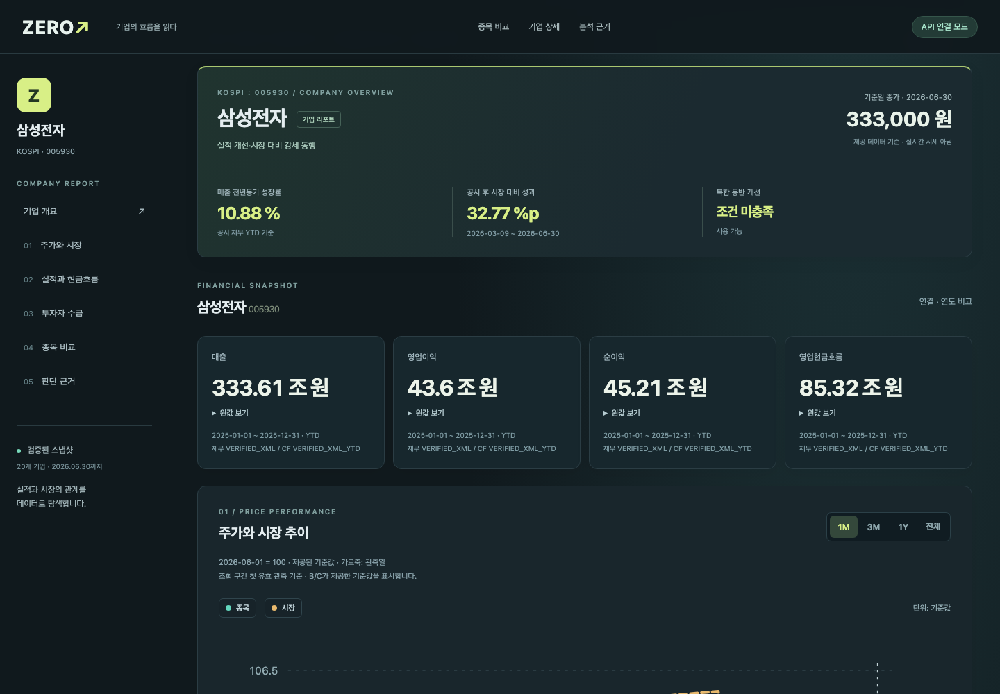
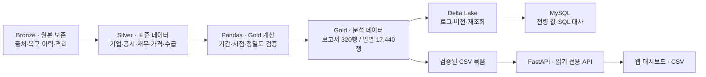
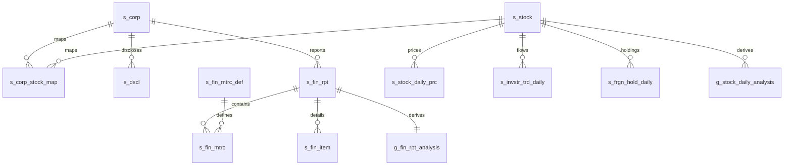
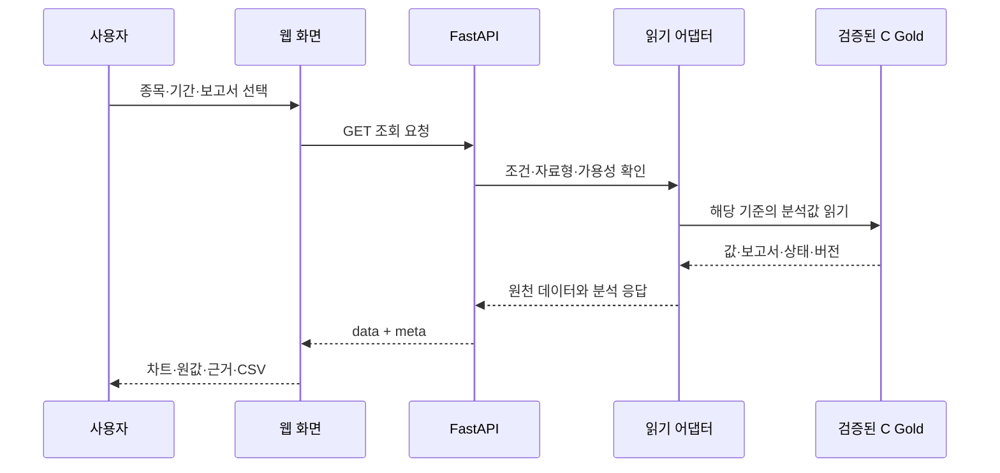
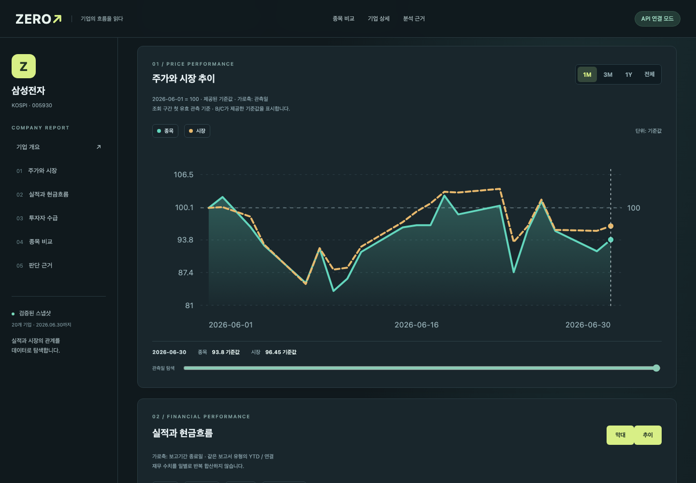
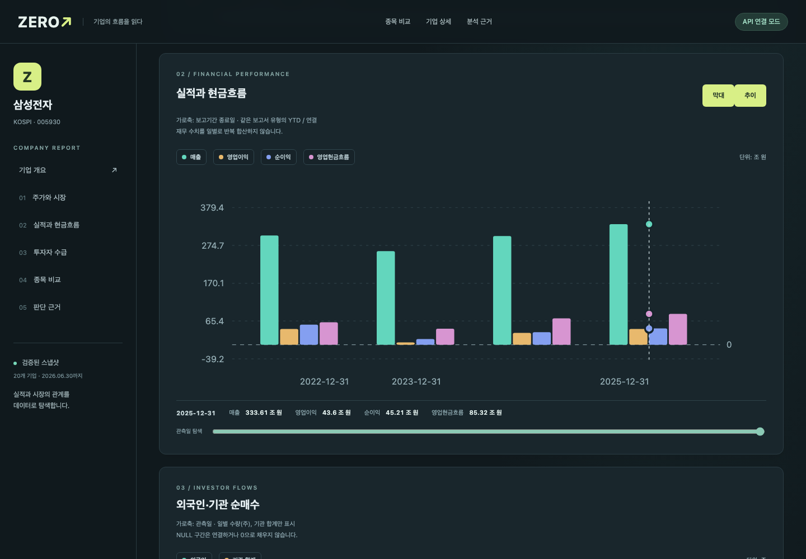
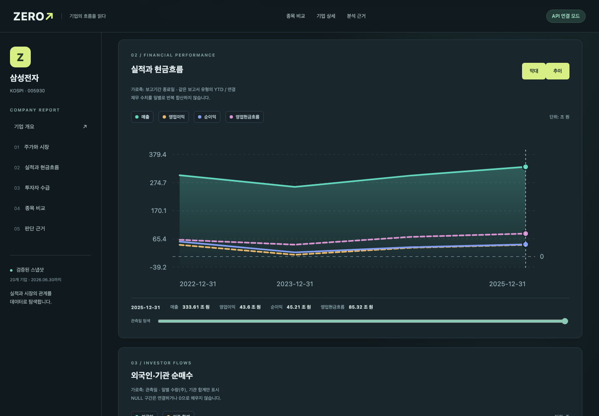
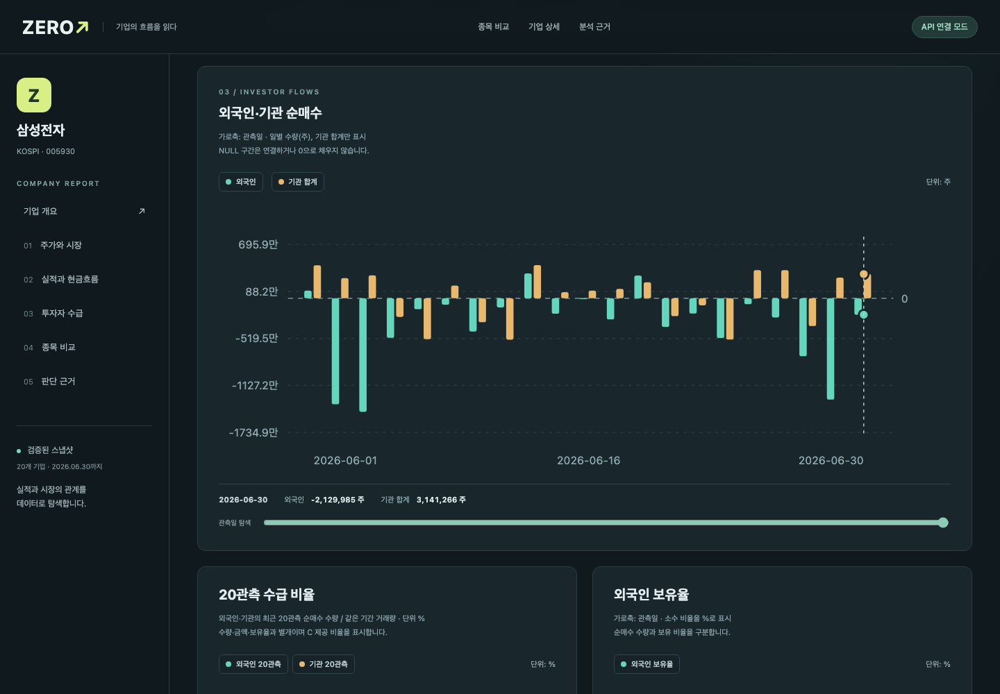
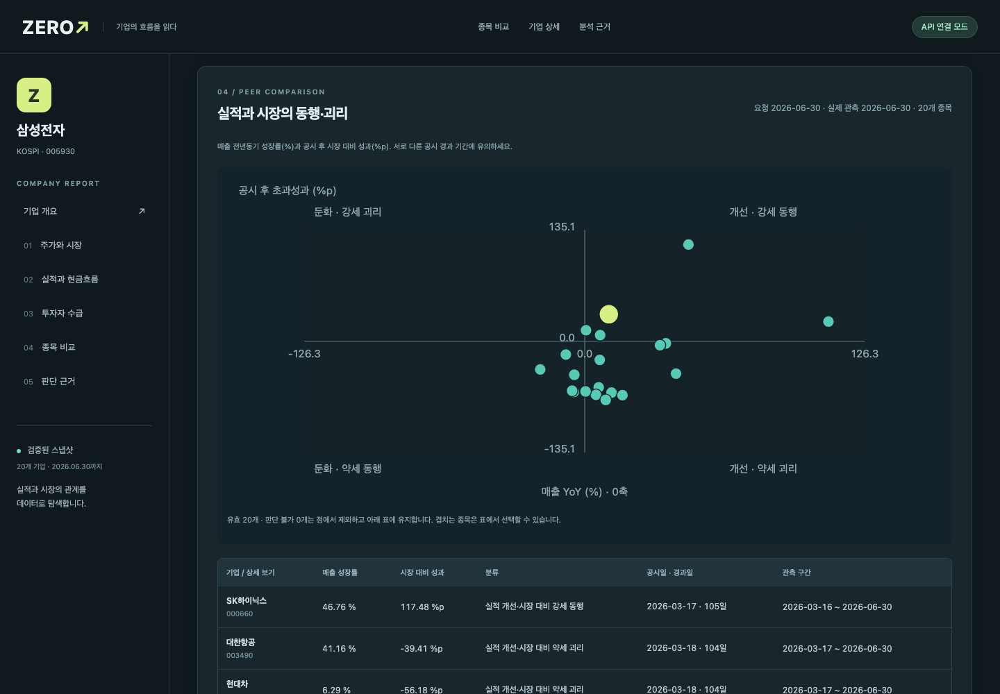
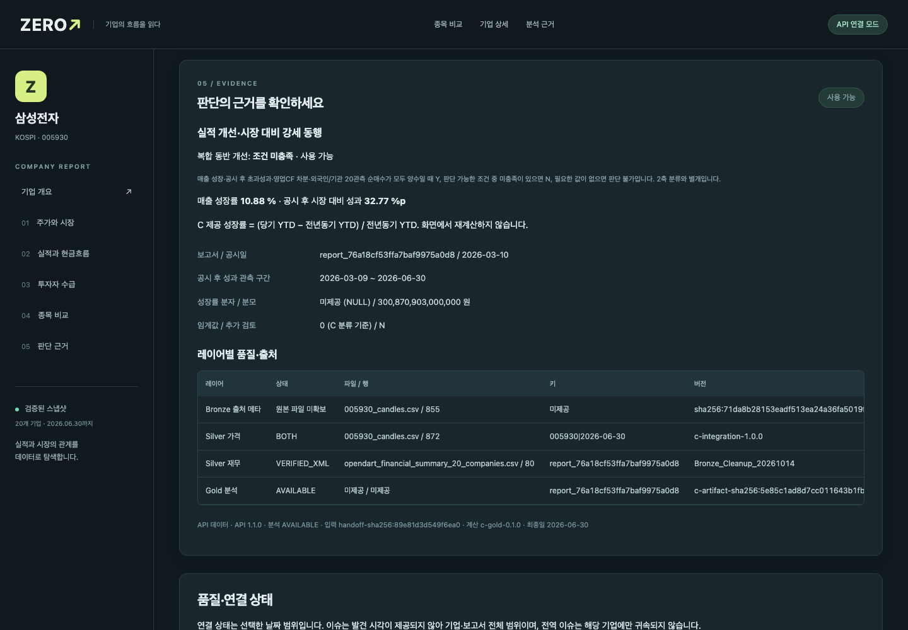

# TEAM ZERO 상세 문서 (전체판)

> 발표 흐름으로 정리한 요약은 [README](../README.md)에 있습니다. 이 문서는 과제 산출물·지표·API·검증의 전체 설명입니다.

## TEAM ZERO · 레거시 데이터의 AI Ready Data 변환 및 표준 사전 구축

**표준화된 데이터에서, 근거를 확인할 수 있는 분석 서비스까지.**
TEAM ZERO는 교환받은 금융 레거시 데이터의 AS-IS 품질을 진단하고, 표준 사전·TO-BE 모델·Delta Lake Medallion 구조·MySQL·SQL/Pandas 검증을 연결하는 프로젝트입니다. Gold 활용 결과로 **ZERO — 기업 실적·현금흐름·투자자 수급·주가의 동행과 괴리를 탐색하는 대시보드**를 제공합니다.

[화면 둘러보기](live-screen-review.md) · [로컬 실행](#로컬-실행) · [데이터와-레이어](#bronze--silver--gold) · [검증 결과](#검증-결과) · [팀 개발 안내](../START_HERE.md)



> **분석 범위:** 20종목 · 가격 872거래일 · 재무 보고서 320건 · 데이터 최종일 2026-06-30
> 고정 데이터 기반의 분석 서비스입니다. 동행·괴리는 관측 결과이며 인과관계나 매매 추천을 뜻하지 않습니다.

## 목차

- [공식 과제와 필수 산출물](#공식-과제와-필수-산출물)
- [프로파일링·표준화·TO-BE·검증·패키징](#과제-수행-방법과-산출물)

1. [프로젝트 개요와 해결하려는 문제](#프로젝트-개요와-해결하려는-문제)
2. [사용자 흐름과 주요 화면](#무엇을-볼-수-있나요)
3. [데이터 출처와 전체 구성](#데이터-출처와-전체-구성)
4. [Bronze → Silver → Gold](#bronze--silver--gold)
5. [데이터 모델과 관계](#데이터-모델과-관계)
6. [핵심 지표와 분석 로직](#핵심-지표와-분석-로직)
7. [요구사항과 단계별 작업](#요구사항과-단계별-작업)
8. [시스템 구조와 API](#시스템-구조와-api)
9. [로컬 실행](#로컬-실행)
10. [검증 결과와 대표 사례](#검증-결과)
11. [트러블슈팅과 데이터 제약](#트러블슈팅)
12. [기술 구성과 팀](#기술-구성과-팀)
13. [용어 사전](#용어-사전)

## 공식 과제와 필수 산출물

### 주제

> **레거시 데이터의 AI Ready Data 변환 및 표준 사전 구축**

과제는 1팀↔2팀, 3팀↔4팀이 현업 레거시 환경을 재현하도록 품질 결함을 반영한 **레거시 데이터셋과 데이터 명세서를 상호 교환**하는 방식입니다. 대상 결함은 결측·중복·형식 불일치·코드값 혼용·명명 규칙 불일치입니다. 받은 데이터를 Pandas로 진단하고, 표준 사전과 TO-BE 모델을 적용해 변환한 뒤 SQL·Pandas로 정합성을 검증합니다.

이 교환 구조는 과제 운영 기준입니다. 현재 저장소의 파일만으로 각 교환 원본이 전부 포함됐거나 모든 원본을 재현했다고 주장하지 않습니다. 최초 오염 원본, 정화 패키지, C 통합 인계본, 이번 신규 Gold를 구분해 출처와 검증 범위를 기록합니다.

| 필수 수행 단계 | 수행 내용 | 주요 산출물 |
|---|---|---|
| **1. 데이터 프로파일링 및 현행(AS-IS) 분석** | 파일·컬럼·키·결측·중복·형식·코드·명명 문제 수치화 | AS-IS 데이터 프로파일링 리포트 |
| **2. 데이터 표준화 전략 수립** | 단어·용어·도메인·코드·조합 규칙·타입·길이·허용값 정의 | AI 데이터 표준 사전, AS-IS/TO-BE 매핑 |
| **3. AI Ready Data 모델링(TO-BE)** | Delta Lake Bronze→Silver→Gold 구조, 개념·논리·물리 ERD, 정규화·식별키·관계 설계 | TO-BE 모델 명세서·ERD·DDL |
| **4. 데이터 변환 및 정합성 검증** | 레이어별 변환·적재, 건수·키·표준·도메인·코드·값 대사 | SQL·Pandas 검증 결과와 분석용 데이터셋 |
| **5. 결과물 패키징 및 회고** | 실행·버전·입출력·검증·잔여 이슈 정리와 역할별 회고 | 재현 가능한 제출 패키지·인수인계·최종 보고 |

대시보드는 이 과정의 **Gold 활용 시연 결과**입니다. 서비스 화면이 있다는 이유로 원본 진단·표준 사전·모델링·검증 산출물을 대신하지 않습니다.

## 과제 수행 방법과 산출물

### 1. Pandas 기반 AS-IS 프로파일링

파일별 행·열 수, 선언 키 중복, 완전 중복, 컬럼별 빈값·유형·값 분포를 확인합니다. 명세에 허용된 선택 결측과 실제 결함을 구분하며, 모든 빈칸을 오류나 0으로 취급하지 않습니다.

| 진단 대상 | 수치·판정 방식 | 주의할 점 |
|---|---|---|
| 결측 | 컬럼별 NULL/빈문자열 건수와 비율 | 필수 여부·기간·계정 특성을 함께 확인 |
| 중복 | 전체 행 중복과 PK 후보 중복 분리 | 같은 기업·날짜라도 보고서/투자자 유형이 다를 수 있음 |
| 형식 | 날짜·숫자·코드 길이·문자 패턴 대조 | 공백·유니코드·선행 0 처리 근거 보존 |
| 코드 혼용 | 표준 코드 사전의 허용 집합과 비교 | 이름만 비슷한 코드를 임의 병합하지 않음 |
| 명명 | 표준 단어·조합·접미어 규칙과 비교 | 원본 컬럼과 표준 컬럼 매핑을 남김 |
| 값·기간 | 금액·매매 항등식·YTD/Q3M·공시일 규칙 | 검토 대상과 확정 오류를 분리 |

저장소의 `01_profiling/asis_table_profile.csv`·`asis_column_profile.csv`는 **C 통합 전 A/B 입력에 대한 보존된 진단 결과**입니다. 이를 최초 오염 원본 전체의 재진단 결과로 바꾸어 설명하지 않습니다. 최초 오염 명세·정화·격리의 추가 근거는 별도 원본 인계 기록에서 추적합니다.

### 2. AI 데이터 표준 사전

고정 인계본의 실제 CSV 행 수는 다음과 같습니다. 신규 Gold 표준어·용어 제안은 별도 산출물이며 이 고정 사전을 덮어쓰지 않습니다.

| 사전 | 건수 | 정의하는 내용 |
|---|---:|---|
| 표준 단어 `std_word` | 168 | 기본 단어와 영문 표기·약어 |
| 표준 용어 `std_term` | 345 | 단어 조합으로 만든 업무 용어·컬럼 |
| 도메인 `std_domain` | 26 | 자료형·길이·값 패턴·허용 범위 |
| 공통 코드 `std_code` | 133 | 코드그룹·값·의미 |
| 명명 규칙 `std_naming_rule` | 12 | 이름 조합·표기·접미어 규칙 |
| 표준 테이블 `std_table` | 23 | 레이어·테이블·행 단위·PK/FK |
| AS-IS/TO-BE 컬럼 매핑 | 260 | 원본 컬럼→표준 컬럼의 대응 |

예를 들어 기업 코드는 CHAR(8)·8자리 숫자 규칙을 적용해 선행 0을 보존합니다. 코드·식별자를 금액처럼 숫자로 변환하지 않으며, 비율·수량·금액은 서로 다른 단위와 도메인으로 관리합니다.

[표준 사전 폴더](../data/03_C_integration_20261014/02_standard_dictionary/)에는 CSV와 Excel 사전이 함께 있습니다.

### 3. TO-BE 설계와 레이어별 구현

- **개념 모델:** 기업·종목·공시·재무·가격·수급·품질의 업무 관계를 정의합니다.
- **논리 모델:** 기업/종목 식별자, 보고서/지표/기간, 종목/거래일/투자자 유형의 행 단위를 분리합니다.
- **물리 모델:** 실제 타입·길이·NULL·PK/FK·인덱스·DDL로 구현하고 Delta 저장 및 MySQL 대사에 연결합니다.
- **정규화:** 재무 지표 정의·공통 코드·기업/종목 매핑을 분리하고, 상세 원천과 집계 결과를 같은 행 단위로 혼합하지 않습니다.
- **Gold 비정규화:** 조회 목적의 보고서·일별 분석 테이블을 만들되 반복된 재무의 합산 금지와 원천 ID를 계약에 남깁니다.

인계본의 Bronze DDL 기준 **18개 입력 테이블**과 B의 오염·정화 보존을 포함한 실제 실행 카탈로그의 **Bronze 28테이블**은 서로 다른 범위입니다. 설계 수와 실행 수를 같은 숫자로 맞추기 위해 자료를 합치거나 누락시키지 않습니다.

### 4. 변환·적재와 SQL/Pandas 정합성 검증

| 검증 축 | 확인하는 내용 | 예시 |
|---|---|---|
| 건수 대사 | 원본→레이어의 입력·출력·제외·격리 건수 | 보고서 320, 가격 17,440 유지 |
| 키 무결성 | PK 중복·NULL, FK 대상·논리 연결 부재 | 기업·종목·보고서 관계 |
| 표준 준수율 | 이름·타입·단어·도메인 규칙 | 표준 컬럼·코드 길이·선행 0 |
| 도메인·코드 | 허용값·패턴·범위·코드 집합 | 날짜·금액·상태·보고서 유형 |
| 값 보존 | 금액·가격·수급과 변환 전후 동등성 | 전체 행·컬럼 digest, Decimal 비교 |
| 업무 규칙 | 공시 경계·기관 합계·기간·분모 | 공시일 < 거래일, 동일기간 비교 |
| 저장 일관성 | Delta 재조회와 MySQL 일치 | 실제 로그·Parquet·버전·전량 대사 |
| 서비스 일관성 | 계산→API→화면·CSV의 같은 값 | 20종목 전량과 대표 사례 |

**보존된 과거 인계본 검증:** 203/203 PASS, 표준 준수율 AS-IS 2.92%→TO-BE 100%, TO-BE 도메인·코드 위반 0. 이는 인계본 `validation_summary.json`의 당시 정의·분모 기준이며 이번 신규 검사 결과로 재계산한 값이 아닙니다.

**이번 신규 Gold 검증:** 17,760행 Delta→MySQL 전량 일치, 독립 SQL 222 PASS, 실제 CSV API·화면 검증을 별도 수행했습니다. 서로 다른 검증 실행을 더해 하나의 성공 건수나 정확도로 표시하지 않습니다.

[과거 검증 요약](../data/03_C_integration_20261014/05_validation/validation_summary.json) · [과거 SQL](../data/03_C_integration_20261014/05_validation/validation_queries.sql)

### 5. AI Ready 데이터셋과 패키징

이 프로젝트의 AI Ready는 **데이터의 의미·시점·단위·키·품질 상태·버전·검증이 정의되어 후속 모델링 입력으로 사용할 수 있는 상태**를 목표로 합니다. 이미 모델을 학습했거나 모든 행이 모든 학습 목적에 적합하다는 뜻은 아닙니다.

| 확정·전달 항목 | 현재 산출물 | 후속 학습에서 정할 항목 |
|---|---|---|
| 분석 행 단위 | 보고서 320행·일별 17,440행 | 예측 대상·샘플 단위 |
| 피처 의미 | 재무·가격·시장·수급의 계산 계약 | 피처 선택·표준화 방법 |
| 시점 | 공시일 기반 PIT·관측 창 | 학습 기준 시점·라벨 생성 시점 |
| 결측 | NULL·미검증·격리·관측 부족 상태 | 목적별 제외·대체·결측 피처 전략 |
| 시간 분리 | `analysis/ai-input.md`에 시간순 분할 제안 | 최종 train/validation/test 확정 |
| 정답 | 현재 Gold에는 예측용 미래 라벨 없음 | 미래 기간·목표·누수 검증 |
| 재현 | 입력/출력 해시·계산 버전·스키마 | 학습 실행 버전과 데이터 고정 |

최종 제출은 **① AS-IS 리포트 ② AI 데이터 표준 사전 ③ TO-BE 명세·ERD·DDL ④ 정합성 검증 데이터셋·SQL/Pandas 결과 ⑤ 실행·인수인계·회고**를 함께 묶습니다. 코드·명세·검증 기록은 저장소로 전달하고, 별도 원본·Delta 실파일·DB 덤프·로컬 실행 로그는 인계 목록과 경로·해시로 관리합니다. 비밀값은 포함하지 않습니다.

회고에는 발견한 문제·선택한 해결·남은 한계·다음 개선을 기록합니다. 본문 트러블슈팅은 실제 검증에서 확인한 기술적 회고이며, 개인별 소감은 작성자 확인 없이 대신 만들지 않습니다.

## 프로젝트 개요와 해결하려는 문제

### 배경

기업의 실적, 현금흐름, 주가, 외국인·기관 수급은 서로 다른 시간 단위와 식별자를 사용합니다. 재무는 보고서 단위이고, 가격·수급은 거래일 단위입니다. 이들을 코드만 맞춰 합치면 공시 전에 알 수 없었던 정보를 사용하거나 같은 누적 실적을 매일 더하는 문제가 생깁니다.

ZERO는 이 데이터를 **시점과 기간의 의미를 보존해 연결하고, 분석값에서 원천 근거까지 되짚을 수 있는 서비스**로 구성했습니다.

| 기존 분석에서 생기는 문제 | ZERO의 처리 방식 | 사용자가 얻는 결과 |
|---|---|---|
| 실적과 주가를 각각 확인해야 함 | 보고서·일별 Gold를 기업·종목 관계로 연결 | 한 기업의 실적·현금·시장 흐름을 한 화면에서 확인 |
| 결산일만 보고 과거 주가에 재무를 붙임 | 실제 공시일보다 뒤인 거래일에만 연결 | 미래 정보 참조를 막은 시점 기준 비교 |
| 누적·분기·기말 값을 섞어 비교 | YTD·Q3M·ASOF와 연결·별도를 구분 | 같은 의미의 재무 지표 비교 |
| 매출은 늘었지만 현금·수급은 약할 수 있음 | 성장·시장 성과 분류에 현금·수급을 보조 근거로 제공 | 단일 숫자로 결론 내리지 않는 추가 검토 |
| 결측을 0으로 바꾸면 잘못된 해석이 발생 | NULL·0·미연결·격리·검토 상태 분리 | 분석할 수 없는 이유까지 확인 |
| 분석 파일과 웹 숫자가 다를 수 있음 | Pandas·Delta·MySQL·API·CSV를 단계별 대사 | 표시값의 출처와 검증 경로 확인 |

### 공동 목표

> **기업 실적·현금흐름·투자자 수급·주가의 동반 개선과 괴리를 탐색하고, 판단 근거와 데이터 품질 상태를 함께 제공한다.**

최종 결과물은 Gold 계산 모듈 하나가 아니라, **분석 데이터 + 저장·검증 도구 + 읽기 전용 API + 웹 대시보드**입니다. 예측 모델은 후속 확장 범위이며 현재 분류는 설명 가능한 규칙에 기반합니다.

### 사용 시나리오

```text
시장·기준일 선택
  → 20종목 비교에서 기업 선택
  → 매출 성장과 시장 대비 성과 확인
  → 실적·현금흐름·외국인·기관 수급 비교
  → 보고서·공시일·기간·품질 상태 확인
  → 같은 조건의 원값·CSV 확인
```

이 서비스는 개별 기업의 변화와 추가 검토 대상을 찾는 데 사용합니다. 보유 20종목 밖의 시장 전체를 대표하는 통계나 투자 성과 보증으로 해석하지 않습니다.

## 무엇을 볼 수 있나요?

| 화면 | 확인할 수 있는 내용 |
|---|---|
| 기업 개요 | 기준일 종가, 매출 성장률, 시장 대비 성과, 복합 동반 개선 여부 |
| 주가와 시장 | 조회 구간 첫 관측일을 100으로 맞춘 종목·시장 추이 |
| 실적과 현금흐름 | 같은 보고서 유형의 매출·영업이익·순이익·영업현금흐름 비교 |
| 투자자 수급 | 외국인·기관 순매수, 관측 구간별 수급과 가격의 흐름 |
| 종목 비교 | 매출 성장과 공시 후 시장 대비 성과의 동행·괴리 비교 |
| 판단 근거 | 계산식·기간·보고서·연결/별도·출처·품질 상태와 정확한 원값 |
| CSV 다운로드 | 현재 조회 조건의 데이터와 분석 결과 반출 |

차트의 관측점 탐색·범례 선택·기간 필터를 지원합니다. 큰 금액은 조·억 단위로 읽고, 원값 보기와 CSV에서 정확한 값을 확인할 수 있습니다.

<details>
<summary><strong>직접 실행한 화면 7장과 캡처 근거 보기</strong></summary>

2026-10-15에 실제 CSV API와 C Gold를 연결해 Chromium에서 직접 캡처했습니다. 삼성전자(005930), 주가 2026-06-01~2026-06-30, 전체 사업연도·사업보고서·연결 조건입니다. 제품 차트를 별도로 다시 그리거나 숫자를 합성하지 않았습니다.

[전체 캡처·재검토 기록](live-screen-review.md) · [이미지 해시·API 버전·검증 메타](media/live-review-20261015/capture-manifest.json)

</details>

## 데이터 출처와 전체 구성

### 출처별 활용

| 출처·인계 자료 | 주요 데이터 | 서비스 활용 | 확인할 점 |
|---|---|---|---|
| OpenDART 계열 인계 데이터 | 기업 고유번호, 공시 접수번호·일자, 재무 보고서·지표·계정·원문 메타 | 기업 연결·기간별 실적·공시 시점·원천 추적 | 원문 메타가 있다는 사실과 원문 파일을 직접 확인한 사실을 구분 |
| 토스증권 계열 인계 데이터 | 종목·시장, 일별 OHLCV, 지수, 투자자별 매매, 외국인 보유, CFD | 가격 성과·시장 비교·수급·보유 변화 | 외부 수집/복구 이력과 현재 API의 고정 데이터 조회를 구분 |
| C 통합 인계본 | 표준 사전·Silver·기존 Gold·DDL·ERD·검증 기록 | 이번 분석과 서비스의 공통 입력 | 저장소 75파일은 읽기 전용 기준본 |
| 추가 확보 정화·원문 자료 | 변경 명세, 복구·격리 로그, 원문 대조 근거 | Bronze/Silver 계보와 기간·금액 검토 | 별도 로컬 자료이며 clone에 모두 들어 있다고 가정하지 않음 |

현재 조회 서버는 이 스냅샷을 읽습니다. 화면을 열 때마다 OpenDART나 증권사에서 새 데이터를 수집하지 않습니다.

### Silver 17테이블

아래 건수는 제공 인계본 기준이며 **서로 다른 행 단위를 합한 물리 행 수**입니다. 고유 기업 수나 독립 표본 수로 해석하지 않습니다.

| 테이블 | 행 수 | 행 단위 | 분석에서 하는 일 |
|---|---:|---|---|
| `s_corp` | 20 | 기업 코드 | 재무·공시의 기업 기준 |
| `s_stock` | 20 | 종목 코드 | 종목명·시장·가격 분석 기준 |
| `s_dscl` | 11,748 | 공시 접수번호 | 공시일과 공시 식별 |
| `s_dscl_doc` | 753 | 원문 대상 | 원문 경로·해시·수집 상태 메타 |
| `s_fin_rpt` | 320 | 재무 보고서 | 사업연도·보고서 유형·연결구분·기간 상태 |
| `s_fin_mtrc_def` | 36 | 표준 지표 | 재무 지표의 정의 |
| `s_fin_mtrc` | 30,080 | 보고서·지표·기간 | 표준화된 재무 금액 |
| `s_fin_item` | 66,729 | 재무 상세 항목 | 표준 지표의 계정 근거 |
| `s_stock_daily_prc` | 17,440 | 종목·거래일 | 종가·OHLCV |
| `s_idx_daily_prc` | 1,744 | 지수·거래일 | 시장 대비 성과 기준 |
| `s_invstr_trd_daily` | 191,829 | 종목·거래일·투자자 유형 | 유형별 순매수·매수·매도 |
| `s_frgn_hold_daily` | 17,439 | 종목·거래일 | 외국인 보유량·보유율 |
| `s_cfd_bal_daily` | 13,719 | 종목·거래일 | CFD 잔고 보조 정보 |
| `s_corp_stock_map` | 20 | 기업·종목 대응 | 기업 데이터와 시장 데이터 연결 |
| `s_conn_stts` | 17,440 | 가격·수급 기준 키 | 원천별 연결 상태 |
| `s_dq_issue` | 1,967 | 품질 이슈 | 검토·격리·유지·제외 근거 |
| `s_cmn_cd` | 133 | 코드그룹·코드 | 상태·분류 코드 정의 |
| **합계** | **371,437** | 여러 행 단위의 합계 | 고유 관측 수와 구분 |

### 표준 사전과 원천 추적

`02_standard_dictionary/`에는 단어·용어·도메인·공통코드·명명규칙·AS-IS/TO-BE 매핑이 있습니다. 표준 테이블 사전은 행 단위와 PK/FK를 정의하며, 분석은 기존 표준 컬럼과 단위를 재사용합니다.

기업은 `corp_cd`, 종목은 `stock_cd`, 공시는 `rcept_no`, 재무는 `fin_rpt_id`로 추적합니다. 소스 파일·행 번호·버전 등 원천 메타는 근거 화면과 품질 검토에서 사용합니다. 새로운 Gold는 계산 버전 `c-gold-0.1.0`으로 구분합니다.

## Bronze → Silver → Gold

공식 과제는 **AS-IS 진단부터 표준 사전·TO-BE 모델·변환·검증·패키징까지** 포함합니다. 이번 C 개발에서는 이미 완료된 Silver 인계본과 표준 사전을 재사용해 Gold와 웹 활용을 완성했습니다. Bronze·Silver 증빙은 기존 자료와 별도 실행 기록으로 연결하며, 단계 전체를 새로 수행한 것처럼 설명하지 않습니다.



그림의 웹 수용 검증 경로는 **CSV 묶음 → API → 화면**입니다. 신규 Gold의 Delta·MySQL 저장은 실제 검증했으며, 신규 MySQL 테이블에서 API까지 직접 조회하는 경로와 구분합니다.

| 레이어 | 담는 내용 | 보존·활용 방식 |
|---|---|---|
| **Bronze** | OpenDART·증권 데이터 입력, 원본 메타, 정화·복구·격리 이력 | 입력 출처와 변경 근거를 추적합니다. 원본 보유 여부와 최초 오염 원본 재현 여부를 구분합니다. |
| **Silver** | 기업·종목·매핑, 공시·원문 메타, 재무 보고서·지표·계정, 가격·지수·투자자 수급·보유·CFD·품질 이슈 | 제공된 **17테이블·371,437행**을 읽기 전용으로 재사용합니다. 키·단위·기간·상태를 유지합니다. |
| **Gold** | 보고서별 실적·현금흐름 지표, 일별 가격·시장 성과·수급 윈도·시점 재무·동행 분류 | 기존 Gold 2개를 보존하고, 목적별 분석 Gold 2개를 추가합니다. |

### 분석용 Gold 테이블

| 테이블 | 행 단위·건수 | 주요 결과 |
|---|---|---|
| `g_fin_rpt_analysis` | 재무 보고서 · **320행** | 전년동기 매출 성장, 영업이익률, 현금흐름 변화·매출 대비 현금흐름, 재무 상태·검증 플래그 |
| `g_stock_daily_analysis` | 종목 × 거래일 · **17,440행** | 수익률·시장 대비 성과, 5/20관측 수급, 시점 적격 재무, 동행·괴리 및 복합 동반 개선 |

기업 20종목은 KOSPI 14개·KOSDAQ 6개입니다. 가격은 2022-12-01~2026-06-30, 재무는 2022~2025년 보고서입니다. 기존 `g_ai_stock_daily`·`g_fin_rpt_mkt_smry`와 신규 분석 테이블은 서로 다른 산출물입니다.

[전체 테이블·컬럼·관계](data-catalog.md) · [데이터 안내](data-guide.md) · [Gold 스키마](https://github.com/2nd-MLOps-engineer-2/Team-Zero/blob/5372c4dade48036e8e3265af66472058417d3cf2/analysis/evidence/schema.json) · [분석 계약](https://github.com/2nd-MLOps-engineer-2/Team-Zero/blob/5372c4dade48036e8e3265af66472058417d3cf2/contracts/analysis.md)

### 숫자를 해석하는 기준

- **공시일 < 거래일:** 공시 시각이 없는 데이터에서 공시 당일 재무를 사용하지 않습니다.
- **기간 구분:** YTD·Q3M·ASOF, 연결·별도, 검증 기간·가정 기간을 구분합니다.
- **중복 합산 방지:** 일별로 연결된 재무를 반복 합산하거나 기관 합계와 기관 세부를 이중 합산하지 않습니다.
- **정밀도 보존:** 금액은 원, 수급은 주, 비율은 소수 비율입니다. Decimal 기반 계산 결과를 API에서 문자열로 전달합니다.
- **상태 보존:** NULL·0·미연결·격리·REVIEW를 구분합니다. 분모 0·음수 기준·관측 부족·기간 미검증은 계산 불가 사유로 표시합니다.

## 데이터 모델과 관계

### 관계를 나눈 이유

기업과 종목은 같은 식별자가 아닙니다. 기업 중심인 공시·재무와 종목 중심인 가격·수급은 `s_corp_stock_map`을 통해 연결합니다. 재무 상세는 보고서 단위, 시장 자료는 종목·거래일 단위에서 먼저 정리한 뒤 분석 목적에 맞게 합칩니다.



위 그림은 서비스 이해를 위한 주요 관계 요약입니다. Gold와의 연결은 분석 계보를 표현하며 모든 선이 실제 DB의 물리 FK라는 뜻은 아닙니다. 공시 범위 밖 재무 보고서 61건 때문에 재무→공시 관계는 완전한 물리 연결로 가정하지 않습니다.

<details>
<summary><strong>인계본 물리 ERD 보기</strong></summary>


인계본 시점의 Bronze·Silver·기존 Gold 모델입니다. 새 분석 Gold 2개는 위 분석 모델과 별도 스키마 명세를 함께 확인합니다.

</details>

## 핵심 지표와 분석 로직

### 1. 재무 보고서별 계산

| 지표 | 계산 | 적격 조건·해석 |
|---|---|---|
| 매출 성장률 | 당기 YTD 매출 / 전년동기 YTD 매출 − 1 | 동일 보고서의 비교 금액·기간 검증, 전년 매출 > 0 |
| 영업이익률 | YTD 영업이익 / YTD 매출 | 동일 기간·연결구분, 매출 > 0 |
| 영업이익 증감액 | 당기 YTD 영업이익 − 전년동기 YTD 영업이익 | 적자→흑자·흑자→적자 전환 상태 별도 |
| 영업현금흐름 증감액 | 당기 YTD 영업CF − 전년동기 YTD 영업CF | 비교 가능한 기간만 사용 |
| 영업CF/매출 | YTD 영업CF / YTD 매출 | 현금흐름 YTD 기간 검증·매출 > 0 |
| 영업CF 성장률 | 당기 YTD 영업CF / 전년동기 영업CF − 1 | 전년 CF > 0, 음수 기준은 별도 상태 |
| 부채비율 | 기말 부채 / 기말 자본 | ASOF끼리 비교, 자본 > 0 |

비율은 내부에서 소수 비율로 저장하고 화면에서 100을 곱해 %로 표시합니다. 비율 계산은 Decimal과 HALF_UP 소수 8자리를 사용합니다. 단순히 금액이 존재한다는 이유로 기간 미검증 보고서의 성장률을 계산하지 않습니다.

### 2. 일별 시장·수급 계산

| 지표 | 계산·구간 | 주의사항 |
|---|---|---|
| 1·5·20관측 가격 성과 | 현재 종가 / n개 관측 전 종가 − 1 | 달력 n일과 다름, 제공 종가 기준 |
| 시장 대비 성과 | 종목 성과 − 같은 구간 지수 성과 | %끼리의 차이는 화면에서 %p |
| 5·20관측 순매수 | 최근 n개 관측의 순매수 수량 합 | 외국인·기관·개인 각각 계산 |
| 순매수 비율 | 같은 창 순매수 수량 합 / 거래량 합 | 수량·거래량 존재, 창 길이 충족, 분모 > 0 |
| 외국인 보유율 변화 | 현재 보유율 − 20개 관측 전 보유율 | 두 시점 값이 필요, %p로 표시 |
| 20관측 변동성 | 유효 일별 수익률 20개의 표본 표준편차 | 연율화 값이 아니며 표본 자유도 1 |
| 기준값 100 차트 | 관측값 / 구간 공통 기준값 × 100 | 종목·지수 공통 유효 관측일을 기준으로 사용 |
| 공시 후 시장 대비 성과 | 공시 직전 보유 거래일→조회일의 종목 성과 − 지수 성과 | 공시 전 가격 기준점과 실제 관측 구간을 명시 |

가격 성과의 20관측 간격은 시작·종료 두 점을 위해 이전 관측이 필요합니다. 순매수 창은 현재 관측을 포함한 최근 20개 행입니다. 길이가 모자라거나 중간에 필수 수급이 없으면 계산 불가 상태를 유지합니다.

### 3. 시점 재무 선택(PIT)

1. 종목과 연결된 기업의 보고서를 조회합니다.
2. 시점 연결 적격이고 **공시일이 거래일보다 앞선** 보고서만 남깁니다.
3. 사업연도·보고서 순서·연결 우선·공시일·접수번호 규칙으로 보고서를 선택합니다.
4. 선택한 보고서 ID·공시일·기간 상태를 일별 Gold에 함께 기록합니다.
5. 적격 보고서가 없으면 재무를 NULL로 두고 미연결 사유를 제공합니다.

예를 들어 어떤 보고서가 6월 15일 공시됐다면 6월 15일 주가에는 그 보고서를 연결하지 않습니다. 이후의 적격 거래일부터 선택할 수 있습니다. 공시 시각을 보유하지 않으므로 당일 공개 시간을 가정하지 않습니다.

### 4. 동행·괴리 분류

| 매출 성장률 | 공시 후 시장 대비 성과 | 코드 | 의미 |
|---:|---:|---|---|
| 양수 | 양수 | `IMPROVE_STRONG` | 실적 개선·시장 대비 강세 동행 |
| 양수 | 음수 | `IMPROVE_WEAK` | 실적 개선·시장 대비 약세 괴리 |
| 음수 | 양수 | `SLOW_STRONG` | 실적 둔화·시장 대비 강세 괴리 |
| 음수 | 음수 | `SLOW_WEAK` | 실적 둔화·시장 대비 약세 동행 |
| 하나라도 0 | 값 존재 | `NEUTRAL` | 경계값으로 별도 분류 |
| 필수 값 없음 | — | `UNAVAILABLE` | 분류 불가 |

**복합 동반 개선**은 매출 성장·공시 후 초과성과·영업CF 증감·외국인 20관측 순매수·기관 20관측 순매수가 모두 양수일 때 Y입니다. 필요한 데이터가 유효하지만 조건을 충족하지 못하면 N, 필수 자료가 부족하면 판단 불가입니다.

이는 종목 매수 신호가 아닙니다. 동일 보고서의 반복 연결과 공시 후 경과 기간 차이를 고려해야 하며, 가격 반응을 실적의 인과 효과라고 해석하지 않습니다.

## 요구사항과 단계별 작업

### 기능·품질 요구사항

| 구분 | 요구사항 | 구현·수용 확인 방식 |
|---|---|---|
| 조회 | 시장·종목·거래기간·사업연도·보고서 유형·연결구분 선택 | API 쿼리 매핑·필터별 화면 검사 |
| 비교 | 같은 기준일의 종목 비교와 상세 이동 | 실제 20종목 전량 비교 |
| 재무 | 보고서별 정확한 금액과 기간 표시 | C 계산·API·화면 원값 대조 |
| 시계열 | 종가·지수·수급·현금흐름 차트 | 기준일·축·단위·결측·툴팁 검사 |
| 근거 | 보고서·공시일·출처·상태 확인 | 원천 메타와 계산 조건 표시 |
| 내보내기 | 조건에 맞는 전체 CSV | 페이지 제한과 분리해 행·키·값 전량 대조 |
| 예외 | 로딩·빈 결과·오류·미연결 상태 | 실제 HTTP와 오류 주입 검사 구분 |
| 정밀도 | 큰 금액·코드 앞자리 0 보존 | Decimal·문자열 계약·회귀검사 |
| 저장 | 실제 Delta 로그와 MySQL 값 대사 | Parquet 재조회·canonical digest·SQL |
| 재현 | 원본 보존·버전·실행법·해시 기록 | 새 run·새 DB 사용, 기존 대상 덮어쓰기 거부 |

### WBS — 단계별 산출물과 인수인계

다음 표는 일정 날짜를 임의로 만든 간트 차트가 아니라, 실제 협업에 사용한 단계와 수용 경계입니다.

| 단계 | 주요 업무 | 주도·수신 | 산출물·확인 기준 |
|---|---|---|---|
| S0 계약 | 입력·출력·필드·단위·예외·환경 정의 | A·B·C 공동 | API·분석·시각화·환경 계약 |
| S1 Bronze | 원본 인수·진단·복구 계보·보존 | B·C | 입력 해시·정화/격리 이력·저장 증빙 |
| S2 Silver | 표준 사전·키·기간·단위·연결 품질 | B ↔ C | 17테이블·PK/FK·기간·수급 검토 |
| S3 Gold | 보고서/일별 계산·Delta·MySQL | C → B, A 해석 검토 | 320/17,440행·SQL 대사·계산 버전 |
| S4 API | 필터·응답·다운로드·화면 연결 | B → A·C | 실제 HTTP·정밀도·전량 숫자 대조 |
| S5 통합 | 동일 사례를 계산→API→화면으로 검수 | A·B·C | 브라우저·CSV·회귀·잔여 범위 보고 |

역할별 세부 작업은 A01~A10, B01~B12, C01~C12이며 공유 인계는 G01~G05로 관리합니다. 전달 브랜치·고정 SHA·실행법·검사 결과를 남기고, 수신자가 자기 코드와 합쳐 확인한 뒤 integration에 통합합니다.

## 시스템 구조와 API

### 실행 구성



화면은 분석값을 다시 계산해 덮어쓰지 않습니다. B는 C 계산 묶음의 계약·해시·행 수·키·타입을 검증해 연결합니다. API 메타에는 데이터 버전·계산 버전·최종일·원천 종류·분석 가용 상태가 포함됩니다.

### 주요 API

| 메서드·경로 | 주요 조건 | 제공 내용 |
|---|---|---|
| `GET /health` | 없음 | 버전·원천·분석 연결 상태 |
| `GET /stocks` | market, q, limit, offset | 종목 목록 |
| `GET /stocks/compare` | as_of, market | 기준일 종목 비교 |
| `GET /stocks/{code}` | 6자리 종목 코드 | 기업·종목 정보 |
| `GET /stocks/{code}/daily` | start, end, limit, offset | 일별 가격·수급·재무·분석 |
| `GET /stocks/{code}/financials` | year, report_code, fs_div, as_of | 보고서·표준 지표·기간 요약 |
| `GET /stocks/{code}/quality` | start, end, limit, offset | 연결·품질 이슈 |
| `GET /analysis/{code}/evidence` | as_of | 계산·보고서·가격 원천 근거 |
| `GET /exports/stocks/{code}/daily.csv` | start, end | 일별 원본 Gold CSV |
| `GET /exports/stocks/{code}/chart.csv` | start, end | 공통 기준100 차트 데이터 |
| `GET /exports/stocks/{code}/financials.csv` | 재무 조회 조건 | 보고서·지표·기간 데이터 |
| `GET /exports/analysis/{table}.csv` | 신규 Gold 테이블명 | C 분석 산출물 |

`report_code`는 사업 11011·반기 11012·1분기 11013·3분기 11014, `fs_div`는 연결 CFS·별도 OFS입니다. 휴일 기준일에는 직전 보유 거래일의 값을 반환하므로 요청일과 실제 관측일을 함께 확인합니다.

### 응답·오류 계약

- 성공 응답은 `data`와 `meta`, 오류는 `error`와 `meta`로 구분합니다.
- 업무 금액·가격·수량·비율은 문자열이며 NULL은 JSON null입니다. 페이지 total/limit/offset은 정수입니다.
- CSV는 UTF-8 BOM, NULL은 빈칸입니다. 숫자 표시 자릿수 차이와 실제 값 차이를 구분합니다.
- 없는 종목은 404, 잘못된 날짜·조건은 422, 신규 분석 미연결은 409, 데이터 소스 사용 불가는 503으로 처리합니다.
- API는 로컬 읽기 전용 서비스입니다. 운영 인증·권한·공개 배포 환경이 완성됐다고 가정하지 않습니다.

## 로컬 실행

### 1. 환경 준비

macOS/Linux 기준입니다. **Python 3.12(B), Python 3.13(C), Node 22.12 이상**을 사용합니다. Windows 설정은 [B 서비스 안내](https://github.com/2nd-MLOps-engineer-2/Team-Zero/blob/5372c4dade48036e8e3265af66472058417d3cf2/backend/service/README.md)를 참고하세요.

```bash
git clone https://github.com/2nd-MLOps-engineer-2/Team-Zero.git
cd Team-Zero
```

현재 서비스 통합 기준은 `integration`입니다. main 승격 전에는 해당 브랜치 또는 이 README가 포함된 작업 브랜치를 사용합니다. 이미 작업 중이라면 변경을 보존한 후 통합합니다.

```bash
# 새 clone에서 서비스 통합본 사용
git switch integration

python3.12 -m venv build/b-venv
build/b-venv/bin/python -m pip install -r backend/service/requirements.lock.txt
python3.13 -m venv build/c-venv
build/c-venv/bin/python -m pip install -r analysis/requirements.txt
npm --prefix apps/web ci
```

### 2. Gold 생성·API 입력 준비

```bash
python3 scripts/check_handoff.py
build/c-venv/bin/python -m analysis.run --output build/analysis
build/b-venv/bin/python backend/service/pack_c_analysis.py \
  --source build/analysis --output build/c-artifact --project-root .
```

Silver는 저장소에 포함되어 있어 다시 업로드할 필요가 없습니다. API 묶음의 출력 경로가 이미 있으면 패키징 도구가 거부하므로 재실행할 때 새 출력 이름을 사용하세요.

### 3. API 실행

```bash
build/b-venv/bin/python backend/service/run.py \
  --backend csv --project-root . --analysis-dir build/c-artifact --port 8000
```

### 4. 별도 터미널에서 화면 실행

```bash
VITE_DATA_MODE=api VITE_API_BASE_URL=http://127.0.0.1:8000 \
  npm --prefix apps/web run dev -- --port 5173 --strictPort
```

- 대시보드: <http://127.0.0.1:5173>
- OpenAPI: <http://127.0.0.1:8000/docs>
- 종료: 각 터미널에서 `Ctrl+C`

화면 기본 모드는 fixture입니다. 위 API 설정을 사용해야 실제 제공 데이터와 연결됩니다. `--analysis-dir`를 생략하면 신규 C 분석은 미연결 상태로 표시됩니다.

## 화면별 시연과 대표 검수 사례

### 1. 주가와 시장



기업과 시장의 출발점을 100으로 맞춰 상대 흐름을 확인합니다. 공통 유효 기준일을 사용하고, 여러 페이지를 조회해도 기준값이 페이지마다 다시 시작하지 않게 검사했습니다.

### 2. 실적과 현금흐름





보고서 유형·연결구분을 맞춰 비교하고 막대/추이를 전환합니다. 카드의 조·억 단위 표시와 정확한 원값을 분리하며, NULL 구간을 연결된 정상 추이처럼 그리지 않습니다.

### 3. 투자자 수급



순매수 수량의 양수·음수를 비교합니다. 기관 합계에 기관 세부 유형을 다시 더하지 않습니다. 외국인 보유율과 일별 순매수, 관측 창 순매수 비율은 서로 다른 지표입니다.

### 4. 종목 비교와 판단 근거





비교표·산점도에서 종목을 선택해 상세로 이동하고, 실적·시장 성과·현금·수급을 함께 확인합니다. 분류 색이나 Y/N만 보지 않고 계산값·기간·보고서·품질 사유까지 따라갈 수 있게 구성했습니다.

### 대표 검수 사례

| 사례 | 확인한 동작 | 기대하는 해석 |
|---|---|---|
| 삼성전자 `005930`, 2026-06-30 | C Gold·B API·화면의 같은 기준 수치 대조 | 값·단위·보고서 연결 일치 |
| `247540`, 2026-04-16 | 주가는 있고 수급이 없는 데이터 | 수급 0으로 대체하지 않고 미제공 표시 |
| 휴일 기준일 | 직전 관측 거래일 선택 | 요청일과 실제 거래일 구분 |
| 공시 당일 | 새 보고서의 당일 PIT 연결 금지 | 미래 정보 참조 방지 |
| C 분석 미연결 API | 원천 금액은 조회, 신규 분석은 미연결 | 합성 분석값으로 자동 대체하지 않음 |
| 빠른 종목 변경·잘못된 기간 | 이전 응답 잔류 방지·다운로드 차단 | 마지막 유효 조건의 결과만 표시 |
| 작은 페이지 크기 | 전체 페이지 조합·공통 가격 기준 유지 | 누락·중복·기준값 재설정 방지 |

## 검증 결과

**2026-10-15 기준**, 실제 제공 데이터와 격리된 로컬 DB 및 GitHub CI로 확인한 결과입니다. 완료된 기능 통합과 최종 main 승격은 구분합니다.

| 검증 | 결과 |
|---|---|
| 인계본 무결성 | 75파일 해시·크기, 33 CSV 헤더·건수 PASS |
| Gold 재생성 | 320 + 17,440행, 기존 제출 결과 해시 일치 |
| Delta → MySQL | 두 Gold 전체 행·컬럼 값 일치 |
| 독립 SQL | **222개 PASS** — NULL·합계·공시일·성장률 대사 |
| C / B API | **49 PASS / 49 PASS·2 SKIP** |
| B 저장 안전성 | 모의 환경 **6 PASS** |
| A 단위 / 빌드 / 브라우저 | **17 PASS / PASS / 18 PASS** |
| 실제 CSV API·다운로드 | 일별·재무·20종목 비교, 값 차이 **0** |
| GitHub 통합 CI | **PASS** — MySQL 8.4·실제 API·브라우저 포함 |

[GitHub 통합 실행 결과](https://github.com/2nd-MLOps-engineer-2/Team-Zero/actions/runs/38698470092) · [Gold 수용 기록](https://github.com/2nd-MLOps-engineer-2/Team-Zero/blob/5372c4dade48036e8e3265af66472058417d3cf2/docs/handoffs/Gold-final-acceptance.md) · [SQL 증빙 JSON](https://github.com/2nd-MLOps-engineer-2/Team-Zero/blob/5372c4dade48036e8e3265af66472058417d3cf2/analysis/evidence/gold-storage-validation.json) · [S5 기록](https://github.com/2nd-MLOps-engineer-2/Team-Zero/blob/5372c4dade48036e8e3265af66472058417d3cf2/docs/handoffs/S5-integration.md)

B 검사 2개는 기존 외부 실행 카탈로그가 필요한 항목으로, 이번 실행에서는 제외됐습니다. CSV의 숫자 표기 차이는 허용하되 키·행·컬럼·값을 대조합니다. 바이트 동일과 값 동일은 구분합니다. 과거 인계본의 203 PASS를 신규 서비스 검증 수치에 합산하지 않습니다.

<details>
<summary><strong>직접 검사하기</strong></summary>

```bash
build/c-venv/bin/python -m unittest discover -s analysis/tests -q
build/b-venv/bin/python -m pytest backend/service/tests -q
npm --prefix apps/web test
npm --prefix apps/web run build
```

Delta/MySQL 신규 DB 대사는 [Gold 수용 기록](https://github.com/2nd-MLOps-engineer-2/Team-Zero/blob/5372c4dade48036e8e3265af66472058417d3cf2/docs/handoffs/Gold-final-acceptance.md)을 따릅니다. 실제 API·브라우저까지 포함하는 재현 절차는 [통합 CI](https://github.com/2nd-MLOps-engineer-2/Team-Zero/blob/5372c4dade48036e8e3265af66472058417d3cf2/.github/workflows/integration.yml)에 있습니다.

</details>

### 첨부 A 수신 검토본과 이번 직접 실행의 구분

첨부 `S4-A-review.zip`과 `S4-B-to-A.md`는 API 1.1.0 수신 당시의 기록입니다. ZIP CRC 검사와 내부 검증 JSON을 확인했습니다. **원래 B 전달 ZIP이 이번 첨부에 없으므로, 내부의 32파일 해시 PASS 기록을 이번 직접 재검증으로 바꾸어 적지 않습니다.**

| 구분 | 첨부 A 검토 당시 | 이번 직접 실행·현재 확인 |
|---|---|---|
| 소스 상태 | A/B 보완 미커밋·PR 대기 | 이후 원격 integration `db98102`에 통합된 코드 실행 |
| A 단위 검사 | 16개 PASS 기록 | 최신 17개 직접 실행·전부 PASS |
| 브라우저 | 16개 PASS 기록 | 실제 Chromium에서 삼성전자 조회·7화면 캡처·페이지 오류 0. 전체 18개 회귀는 앞선 통합 검증 기록과 구분 |
| API/C 대조 | 재무 320·일별 17,440행 일치 기록 | 같은 전량·20종목·다운로드 값 대조 직접 재실행 PASS |
| 이미지 | 전달 당시 화면 보고 | API 1.1.0·analysis AVAILABLE·synthetic=false 확인 후 직접 캡처 |
| DB/Delta | 별도 검증 필요 | 이번 캡처 작업은 CSV API. 앞선 Gold 저장 수용 검증과 구분 |

이번 캡처의 실제 종가는 **333,000원**, 화면 표시 매출 성장률 **10.88%**, 공시 후 시장 대비 성과 **32.77%p**, 복합 동반 개선은 **조건 미충족**입니다. 2026-06-30 스냅샷 기준 표시값이며 실시간 시세나 투자 판단이 아닙니다. 정확한 원래 숫자는 Gold·API 계약을 따릅니다.

[상세 수신 검토·실행 환경·캡처 기록](live-screen-review.md)

### 데이터 제약과 남은 범위

기간 미검증 **61보고서**, 시점 재무 미연결 **1,607행**, 수급 격리 **1키**, 기간 연속성 REVIEW를 상태값으로 보존합니다. 이를 임의 값이나 0으로 채우지 않습니다.

신규 Gold 저장·CSV API·화면 수용 검증은 완료했습니다. **전체 Bronze 재현·기존 58테이블 복원 증빙의 최종 검토, 신규 MySQL → API 직접 조회 검증, main 승격·운영 배포**는 별도 범위입니다. 고정 인계본에는 별도 Bronze 입력·공시 원문 ZIP·덤프·Delta 실파일이 모두 포함되는 것은 아닙니다.

## 트러블슈팅

| 문제 | 원인·위험 | 적용한 해결·검증 |
|---|---|---|
| API 다운로드와 Gold 파일 해시가 다름 | `100`과 `100.0000`처럼 소수 표기 차이가 실제 값 오류로 잡힘 | 숫자형 선언 컬럼만 Decimal로 동등성 비교, 키·문자열은 정확히 비교. 원래 파일 해시는 별도 보존 |
| 코드 앞자리 0이 사라져도 통과할 수 있음 | 모든 문자열을 숫자로 비교하면 종목·보고서 식별자가 왜곡됨 | 스키마 기반 숫자 컬럼 제한, 코드·날짜·ID·버전 정확 비교 |
| 대조 실패인데 CLI가 정상 종료 | 결과 JSON만 FAIL이고 자동화는 성공으로 판단 | 실패 종료코드 1·성공 0, 실제 subprocess 회귀검사 |
| 목록에 있는 종목이 404여도 누락을 못 찾음 | Gold에 행이 없다는 이유로 API 계약 실패를 통과 처리 | 종목 목록과 상세 응답을 함께 검사, 페이지 중간 오류도 실패 |
| MySQL 성장률 재계산이 불일치 | 기본 나눗셈 정밀도는 C의 소수 8자리 반올림과 다름 | SQL 세션 `div_precision_increment=30`, 259개 적격 보고서 불일치 0 확인 |
| 큰 재무 금액의 숫자가 바뀜 | JavaScript Number의 정수 정밀도 한계 | API 문자열·표시용 정수 처리·원값 보존, 차트 좌표와 정확한 숫자 구분 |
| 검토 중인 데이터가 정상으로 보임 | 결측을 0으로 채우거나 가정 기간을 검증 기간처럼 사용 | 상태 코드·이유를 계산값과 함께 전달, REVIEW·격리 유지 |

## 용어 사전

| 용어 | 이 프로젝트에서의 의미 |
|---|---|
| Bronze | 입력 자료와 출처·변경 계보를 보존하는 계층 |
| Silver | 표준 이름·타입·키·기간·품질 상태로 통합된 계층 |
| Gold | 분석 목적에 맞게 지표·윈도·분류를 계산한 계층 |
| Delta Lake | Parquet와 트랜잭션 로그로 테이블 버전을 관리하는 저장 형식 |
| `_delta_log` | Delta 변경·스냅샷 메타가 기록되는 실제 로그 디렉터리 |
| PIT | 해당 시점에 이용 가능했던 정보만 연결하는 방식 |
| YTD / PRIOR_YTD | 당기 누적 / 같은 보고서의 전년동기 누적 |
| Q3M / ASOF | 해당 3개월 기간 / 특정 기말 시점 |
| CFS / OFS | 연결재무제표 / 별도재무제표 |
| TOP_LEVEL 수급 | 기관 합계와 세부를 중복하지 않는 최상위 투자자 구분 |
| 초과성과 | 같은 기간 종목 수익률에서 시장 지수 수익률을 뺀 값 |
| % / %p | 비율 / 비율 간 차이를 표시하는 단위 |
| NULL / 0 | 값이 없거나 계산 불가 / 실제 측정값이 0 |
| canonical digest | 행 순서·자료형 표현을 표준화한 값 기반 해시 |
| fixture / mock | 재현 가능한 샘플 입력 / 실제 외부 의존성을 대신한 검사 대상 |
| handoff | 고정 커밋·실행법·기대값·검증 결과를 담은 역할 간 전달 |

## 기술 구성과 팀

| 영역 | 기술·담당 | 구현 경로 |
|---|---|---|
| 화면 | Vite · JavaScript · Playwright / **A 이어진** | `apps/web/` |
| 저장·API | FastAPI · Delta Lake · MySQL / **B 설호현** | `backend/service/`, `backend/medallion_pipeline/` |
| 분석·검증 | Pandas · NumPy · Decimal · Matplotlib / **C 김형준** | `analysis/` |
| 공통 | 계약·샘플·인수인계·GitHub Actions | `contracts/`, `fixtures/`, `docs/handoffs/`, `.github/workflows/` |

고정 인계본은 `data/03_C_integration_20261014/`에 보존합니다. 생성물·DB·Delta·실행 로그는 `build/` 등 별도 위치에 두며 비밀번호와 DB 덤프를 커밋하지 않습니다.

팀원은 [AGENTS.md](../AGENTS.md) → [START_HERE.md](../START_HERE.md) → [본인 역할 프롬프트](../prompts/) 순서로 시작합니다. 작업 브랜치에서 개발하고 단계별 검증·수신 확인 후 integration에 통합합니다.

[프로젝트 설계](project-plan.md) · [업무 체크북](workbook.md) · [계약 모음](../contracts/README.md) · [통합 진행표](integration-status.md) · [브랜치·인수인계 절차](integration-workflow.md)
